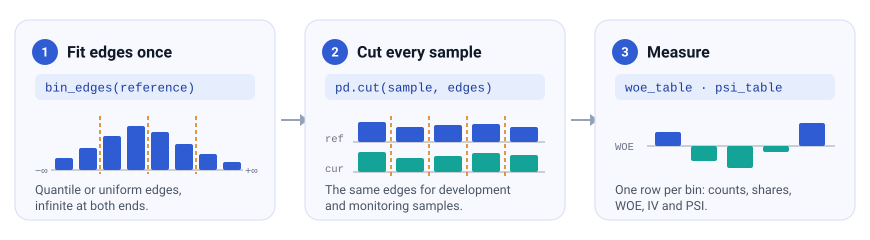

<div align="center">


# kivi

**Binning, WOE, IV and PSI for pandas**

Fit bin edges once, see how well every bin separates a binary target,<br>
and watch your population drift — all as plain pandas DataFrames.

[](https://pypi.org/project/kivi/)
[](https://pypi.org/project/kivi/)
[](https://github.com/gchensy/kivi/actions/workflows/docs.yml)
[](https://www.python.org/)
[](https://pandas.pydata.org/)
[](https://gchensy.github.io/kivi/)
[](https://github.com/gchensy/kivi/blob/master/LICENSE)
[](https://github.com/gchensy/kivi)

**English** · [简体中文](https://github.com/gchensy/kivi/blob/master/README.zh-CN.md)

[Documentation](https://gchensy.github.io/kivi/en/) ·
[Quickstart](https://gchensy.github.io/kivi/en/getting_started/quickstart.html) ·
[User guide](https://gchensy.github.io/kivi/en/user_guide/index.html) ·
[API](https://gchensy.github.io/kivi/en/api.html) ·
[Release notes](https://gchensy.github.io/kivi/en/release/index.html)

</div>

---

## ✨ Highlights

- 📐 **Fit once, reuse everywhere.** `bin_edges` learns quantile or uniform edges on a reference sample. The outer edges are infinite, so every future value still lands in a bin.
- 🔍 **Transparent results.** `woe_table` and `psi_table` return raw counts, smoothed shares and a contribution per bin, not just one number.
- 🧩 **Nothing silently dropped.** Missing values, special codes such as `-1` and categories seen in only one sample get their own group.
- 🧊 **Honest smoothing.** Empty cells are replaced by `smoothing` (default 0.5) before normalizing, and the reported counts are never altered.
- 🐼 **Just pandas and NumPy.** No Spark, no database drivers and no global random state in the core.
- 🌏 **Bilingual, tested docs.** Every example in the English and Chinese manuals runs in CI.

## 🧭 How it works

<p align="center">
  
</p>

## 📦 Installation

```bash
pip install kivi
```

Requires Python 3.10+, NumPy 1.24+ and pandas 2.0+. For the latest development version, use `pip install "git+https://github.com/gchensy/kivi"`.

> **Upgrading from 0.2.x?** The API changed in 0.3. Read the [migration guide](https://gchensy.github.io/kivi/en/release/migration.html) before upgrading existing code.

## 🚀 Quickstart

```python
import pandas as pd
from kivi.binning import bin_edges
from kivi.datasets import Dataset
from kivi.evaluate import psi_table
from kivi.woe import woe_table

data = Dataset.bank_data()                      # 4,521 bank marketing customers
reference, current = data.iloc[:3000], data.iloc[3000:]

edges = bin_edges(reference["age"], bins=5)     # 1. fit once on the reference
before = pd.cut(reference["age"], edges)        # 2. cut every sample
after = pd.cut(current["age"], edges)

evidence = woe_table(before, reference["target"])  # 3. measure
stability = psi_table(before, after)

print(evidence[["event", "non_event", "woe", "iv"]].round(3))
print(f"IV = {evidence['iv'].sum():.3f}, PSI = {stability['psi'].sum():.4f}")
```

```text
              event  non_event    woe     iv
bin
(-inf, 32.0]     90        612  0.114  0.003
(32.0, 36.0]     55        475 -0.125  0.003
(36.0, 42.0]     58        529 -0.180  0.006
(42.0, 51.0]     71        569 -0.050  0.001
(51.0, inf]      74        467  0.189  0.007
IV = 0.019, PSI = 0.0024
```

Categorical columns skip the edges entirely:

```python
jobs = woe_table(reference["job"], reference["target"])
print(f"IV(job) = {jobs['iv'].sum():.3f}")      # IV(job) = 0.137
```

## 🧰 API at a glance

| Function | What it does |
| --- | --- |
| [`kivi.binning.bin_edges`](https://gchensy.github.io/kivi/en/api.html#kivi.binning.bin_edges) | Fit quantile or uniform edges on a reference sample, with infinite outer edges |
| [`kivi.binning.cut`](https://gchensy.github.io/kivi/en/api.html#kivi.binning.cut) | Assign values to bins, with a separate group for each special value such as `-1` |
| [`kivi.woe.woe_table`](https://gchensy.github.io/kivi/en/api.html#kivi.woe.woe_table) | Counts, shares, WOE and IV for every group |
| [`kivi.evaluate.psi_table`](https://gchensy.github.io/kivi/en/api.html#kivi.evaluate.psi_table) | Per-group PSI contributions between two samples |
| [`kivi.datasets.Dataset.bank_data`](https://gchensy.github.io/kivi/en/api.html#kivi.datasets.Dataset.bank_data) | The bundled bank marketing data |

## 📚 Documentation

| | English | 中文 |
| --- | --- | --- |
| Quickstart | [Read](https://gchensy.github.io/kivi/en/getting_started/quickstart.html) | [阅读](https://gchensy.github.io/kivi/zh/getting_started/quickstart.html) |
| Binning | [Read](https://gchensy.github.io/kivi/en/user_guide/binning.html) | [阅读](https://gchensy.github.io/kivi/zh/user_guide/binning.html) |
| WOE and IV | [Read](https://gchensy.github.io/kivi/en/user_guide/woe_iv.html) | [阅读](https://gchensy.github.io/kivi/zh/user_guide/woe_iv.html) |
| PSI | [Read](https://gchensy.github.io/kivi/en/user_guide/psi.html) | [阅读](https://gchensy.github.io/kivi/zh/user_guide/psi.html) |
| Migrating from 0.2.x | [Read](https://gchensy.github.io/kivi/en/release/migration.html) | [阅读](https://gchensy.github.io/kivi/zh/release/migration.html) |

## 🗺️ Roadmap

- ✅ Quantile and uniform binning, WOE, IV and PSI on a pandas core
- ✅ English and Simplified Chinese documentation with tested examples
- ✅ Special values such as `-1` or `-999` in their own bins
- 🔜 Scorecard workflow, validated against fixed reference samples
- 🔜 Weighted and supervised binning
- 🔜 Spark and SQL as optional integrations

## 🤝 Contributing

```bash
git clone https://github.com/gchensy/kivi.git
cd kivi
python -m pip install -e '.[test,docs]'
python -m pytest                                          # unit tests
python -m sphinx -W -b doctest docs docs/_build/doctest   # documentation examples
python docs/build.py                                      # English and Chinese HTML
```

After editing English pages or docstrings, run `python docs/build.py --update-po` and translate the new entries in `docs/locale/zh_CN/LC_MESSAGES/kivi.po`. See the [development guide](https://gchensy.github.io/kivi/en/development/index.html) for details.

## 📄 License

The code is released under the [MIT License](https://github.com/gchensy/kivi/blob/master/LICENSE). The bundled Bank Marketing data by S. Moro, P. Rita and P. Cortez (2014) is licensed under CC BY 4.0; see [DATA-LICENSE.txt](https://github.com/gchensy/kivi/blob/master/DATA-LICENSE.txt).

<div align="center">

<sub>If kivi helps your models, a ⭐ helps others find it.</sub>

</div>
