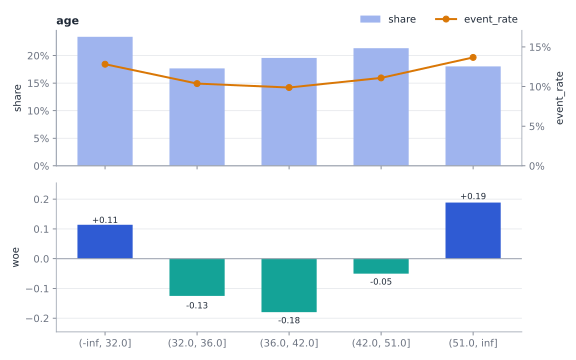
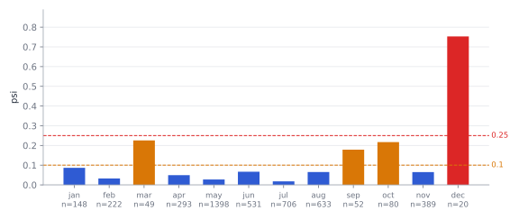
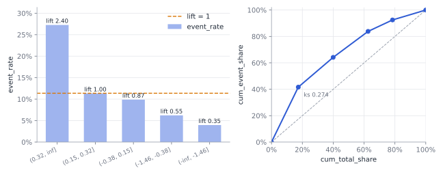
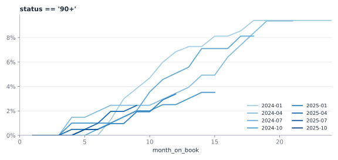
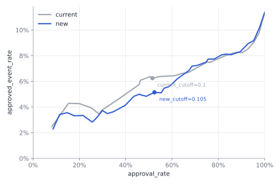
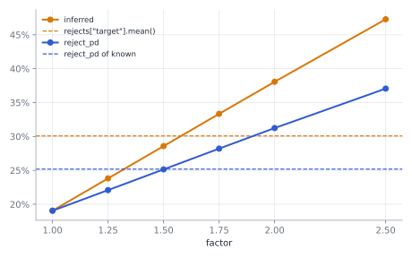

<div align="center">


# kivi

**Credit risk modeling with pandas**

A toolkit for the whole scorecard project:<br>
screen and bin the variables, fit and scale the model, calibrate it, price the cut-offs and monitor what it approves.

[](https://pypi.org/project/kivi/)
[](https://pypi.org/project/kivi/)
[](https://github.com/gchensy/kivi/actions/workflows/docs.yml)
[](https://www.python.org/)
[](https://pandas.pydata.org/)
[](https://gchensy.github.io/kivi/)
[](https://github.com/gchensy/kivi/blob/master/LICENSE)
[](https://github.com/gchensy/kivi)

**English** · [简体中文](https://github.com/gchensy/kivi/blob/master/README.zh-CN.md)

[Documentation](https://gchensy.github.io/kivi/en/) ·
[Quickstart](https://gchensy.github.io/kivi/en/getting_started/quickstart.html) ·
[User guide](https://gchensy.github.io/kivi/en/user_guide/index.html) ·
[API](https://gchensy.github.io/kivi/en/api.html) ·
[Release notes](https://gchensy.github.io/kivi/en/release/index.html)

</div>

---

## ✨ Highlights

- 🏦 **Built for risk teams.** Covers a credit scorecard project end to end: variable profiles, classing, variable selection, reject inference, a logistic fit, scaling to points, evaluation, calibration on a master scale, cut-off strategy and expected loss, deployment and monitoring, plus vintage and roll-rate analysis of the approved loans.
- 📐 **Fit once, reuse everywhere.** Bin edges, WOE tables, master scales and cut-offs are fitted on the development sample and applied unchanged to later samples. `bin_edges` learns quantile or uniform edges, and `chimerge_edges`, `tree_edges` and `monotonic_edges` also use the target. The outer edges are infinite, so every future value still lands in a bin.
- 🔍 **Transparent results.** Tables return raw counts, smoothed shares and a contribution per bin, grade or cut-off, not just one number.
- 💾 **Reproducible in production.** `fit_spec` bins a whole data frame, and `BinningSpec` saves the edges and WOE tables as versioned JSON, so production groups new data exactly as development did.
- 🧩 **Nothing silently dropped.** Missing values, special codes such as `-1` and categories seen in only one sample get their own group.
- ⚖️ **Sample weights throughout.** Binning, WOE, PSI, the metrics, calibration, the model fits and the strategy tables take `weights`, and integer weights give the same results as repeated rows.
- 🧊 **Honest smoothing.** Empty cells are replaced by `smoothing` (default 0.5) before normalizing, and the reported counts are never altered.
- 🐼 **Just pandas and NumPy.** No Spark, no database drivers and no global random state in the core.
- 🌏 **Bilingual, tested docs.** Every example in the English and Chinese manuals runs in CI.

## 📊 Gallery

<table>
  <tr>
    <td width="50%" valign="top">
      <a href="https://gchensy.github.io/kivi/en/user_guide/woe_iv.html#charting-woe"></a>
      <br><b>WOE chart</b>: share of customers, event rate and WOE per bin.
    </td>
    <td width="50%" valign="top">
      <a href="https://gchensy.github.io/kivi/en/user_guide/risk_workflow.html"></a>
      <br><b>Variable screening</b>: IV ranking with the usual reading bands; <code>duration</code> is a leak.
    </td>
  </tr>
  <tr>
    <td colspan="2" valign="top">
      <a href="https://gchensy.github.io/kivi/en/user_guide/psi.html#monitoring-over-time"></a>
      <br><b>Monitoring</b>: PSI per period against the development sample, with the 0.1 and 0.25 thresholds and sample sizes.
    </td>
  </tr>
  <tr>
    <td width="50%" valign="top">
      <a href="https://gchensy.github.io/kivi/en/user_guide/metrics.html#gains-table"></a>
      <br><b>Gains</b>: event rate and lift per score band, and the share of events captured.
    </td>
    <td width="50%" valign="top">
      <a href="https://gchensy.github.io/kivi/en/user_guide/vintage.html#vintage-curves"></a>
      <br><b>Vintage curves</b>: cumulative 90+ bad rate of each origination cohort.
    </td>
  </tr>
  <tr>
    <td width="50%" valign="top">
      <a href="https://gchensy.github.io/kivi/en/user_guide/strategy.html#swap-sets"></a>
      <br><b>Cut-off strategy</b>: the bad rate of the approved book at each approval rate, for a current and a new score.
    </td>
    <td width="50%" valign="top">
      <a href="https://gchensy.github.io/kivi/en/user_guide/reject_inference.html#sensitivity-to-the-factor"></a>
      <br><b>Reject inference</b>: the inferred bad rate and the refitted PD of the declined applicants for each <code>factor</code>.
    </td>
  </tr>
</table>

## 🧭 How it works

Every step fits on the development sample and applies the result unchanged to later samples:

| Step | Modules | Main functions |
| --- | --- | --- |
| Profile the candidates | `kivi.univariate` | `profile_table` |
| Bin and encode | `kivi.binning`, `kivi.woe` | `bin_edges`, `monotonic_edges`, `woe_table`, `woe_transform` |
| Select and fit | `kivi.selection`, `kivi.reject_inference` | `stepwise`, `logistic_regression`, `fuzzy_augmentation` |
| Scale and evaluate | `kivi.scorecard`, `kivi.metrics` | `points_table`, `roc_auc`, `ks`, `gains_table` |
| Calibrate | `kivi.calibration` | `master_scale`, `assign_grades`, `jeffreys_test` |
| Decide | `kivi.strategy` | `cutoff_table`, `swap_set`, `expected_loss_table` |
| Deploy and monitor | `kivi.spec`, `kivi.stability`, `kivi.vintage` | `fit_spec`, `psi_table`, `csi_table`, `vintage_table` |

Binning shows the pattern: fit the edges once, cut every sample with them, then measure.

<p align="center">
  
</p>

## 📦 Installation

```bash
pip install kivi
```

Requires Python 3.10+, NumPy 1.24+ and pandas 2.0+. For the latest development version, use `pip install "git+https://github.com/gchensy/kivi"`.

> **Upgrading from 0.2.x?** The API changed in 0.3. Read the [migration guide](https://gchensy.github.io/kivi/en/release/migration.html) before upgrading existing code.

## 🚀 Quickstart

```python
import pandas as pd
from kivi.binning import bin_edges
from kivi.datasets import Dataset
from kivi.stability import psi_table
from kivi.woe import woe_table

data = Dataset.bank_data()                      # 4,521 bank marketing customers
reference, current = data.iloc[:3000], data.iloc[3000:]

edges = bin_edges(reference["age"], bins=5)     # 1. fit once on the reference
before = pd.cut(reference["age"], edges)        # 2. cut every sample
after = pd.cut(current["age"], edges)

evidence = woe_table(before, reference["target"])  # 3. measure
stability = psi_table(before, after)

print(evidence[["event", "non_event", "woe", "iv"]].round(3))
print(f"IV = {evidence['iv'].sum():.3f}, PSI = {stability['psi'].sum():.4f}")
```

```text
              event  non_event    woe     iv
bin
(-inf, 32.0]     90        612  0.114  0.003
(32.0, 36.0]     55        475 -0.125  0.003
(36.0, 42.0]     58        529 -0.180  0.006
(42.0, 51.0]     71        569 -0.050  0.001
(51.0, inf]      74        467  0.189  0.007
IV = 0.019, PSI = 0.0024
```

Categorical columns skip the edges entirely:

```python
jobs = woe_table(reference["job"], reference["target"])
print(f"IV(job) = {jobs['iv'].sum():.3f}")      # IV(job) = 0.137
```

## 🧰 API at a glance

| Function | What it does |
| --- | --- |
| [`kivi.univariate.profile_table`](https://gchensy.github.io/kivi/en/api/univariate.html#kivi.univariate.profile_table) | One row per candidate: missing values, distribution, event rates, the IV of a quick binning and the Gini of numeric values |
| [`kivi.binning.bin_edges`](https://gchensy.github.io/kivi/en/api/binning.html#kivi.binning.bin_edges) | Fit quantile or uniform edges on a reference sample, with infinite outer edges |
| [`kivi.binning.cut`](https://gchensy.github.io/kivi/en/api/binning.html#kivi.binning.cut) | Assign values to bins, with a separate group for each special value such as `-1` |
| [`kivi.binning.chimerge_edges`](https://gchensy.github.io/kivi/en/api/binning.html#kivi.binning.chimerge_edges) | Merge fine quantile bins with ChiMerge until neighbours differ significantly |
| [`kivi.binning.tree_edges`](https://gchensy.github.io/kivi/en/api/binning.html#kivi.binning.tree_edges) | Decision-tree splits by entropy or Gini, with a minimum share per bin |
| [`kivi.binning.monotonic_edges`](https://gchensy.github.io/kivi/en/api/binning.html#kivi.binning.monotonic_edges) | Merge fine quantile bins until the WOE is monotonic |
| [`kivi.woe.woe_table`](https://gchensy.github.io/kivi/en/api/woe.html#kivi.woe.woe_table) | Counts, shares, WOE and IV for every group |
| [`kivi.woe.woe_transform`](https://gchensy.github.io/kivi/en/api/woe.html#kivi.woe.woe_transform) | Replace each group with its development WOE, with an explicit policy for unseen groups |
| [`kivi.woe.woe`](https://gchensy.github.io/kivi/en/api/woe.html#kivi.woe.woe), [`kivi.woe.iv`](https://gchensy.github.io/kivi/en/api/woe.html#kivi.woe.iv), [`kivi.stability.psi`](https://gchensy.github.io/kivi/en/api/stability.html#kivi.stability.psi) | WOE, IV and PSI from counts that are already aggregated |
| [`kivi.selection.correlation_filter`](https://gchensy.github.io/kivi/en/api/selection.html#kivi.selection.correlation_filter), [`kivi.selection.vif`](https://gchensy.github.io/kivi/en/api/selection.html#kivi.selection.vif) | Drop correlated variables by IV, and variance inflation factors |
| [`kivi.selection.logistic_regression`](https://gchensy.github.io/kivi/en/api/selection.html#kivi.selection.logistic_regression), [`kivi.selection.stepwise`](https://gchensy.github.io/kivi/en/api/selection.html#kivi.selection.stepwise) | NumPy logistic regression and stepwise selection that keeps every coefficient positive, with frequency weights |
| [`kivi.reject_inference.fuzzy_augmentation`](https://gchensy.github.io/kivi/en/api/reject_inference.html#kivi.reject_inference.fuzzy_augmentation), [`kivi.reject_inference.parceling`](https://gchensy.github.io/kivi/en/api/reject_inference.html#kivi.reject_inference.parceling), [`kivi.reject_inference.reweighting`](https://gchensy.github.io/kivi/en/api/reject_inference.html#kivi.reject_inference.reweighting) | Infer the outcomes of declined applicants, as weighted rows or as weights of the approved ones |
| [`kivi.scorecard.score_scaling`](https://gchensy.github.io/kivi/en/api/scorecard.html#kivi.scorecard.score_scaling), [`kivi.scorecard.pd_to_score`](https://gchensy.github.io/kivi/en/api/scorecard.html#kivi.scorecard.pd_to_score), [`kivi.scorecard.score_to_pd`](https://gchensy.github.io/kivi/en/api/scorecard.html#kivi.scorecard.score_to_pd) | PDO scaling factor and offset, and conversion between PD and score |
| [`kivi.scorecard.points_table`](https://gchensy.github.io/kivi/en/api/scorecard.html#kivi.scorecard.points_table), [`kivi.scorecard.woe_to_points`](https://gchensy.github.io/kivi/en/api/scorecard.html#kivi.scorecard.woe_to_points), [`kivi.scorecard.reason_codes`](https://gchensy.github.io/kivi/en/api/scorecard.html#kivi.scorecard.reason_codes) | Points per group with PDO scaling, scores for new data, and reason codes |
| [`kivi.metrics.roc_auc`](https://gchensy.github.io/kivi/en/api/metrics.html#kivi.metrics.roc_auc), [`kivi.metrics.gini`](https://gchensy.github.io/kivi/en/api/metrics.html#kivi.metrics.gini), [`kivi.metrics.ks`](https://gchensy.github.io/kivi/en/api/metrics.html#kivi.metrics.ks), [`kivi.metrics.brier_score`](https://gchensy.github.io/kivi/en/api/metrics.html#kivi.metrics.brier_score) | AUC, Gini, KS and Brier score of a score or PD against a binary target |
| [`kivi.metrics.gains_table`](https://gchensy.github.io/kivi/en/api/metrics.html#kivi.metrics.gains_table) | Gains and lift by score band, with cumulative capture and KS |
| [`kivi.calibration.master_scale`](https://gchensy.github.io/kivi/en/api/calibration.html#kivi.calibration.master_scale), [`kivi.calibration.fit_grade_pd`](https://gchensy.github.io/kivi/en/api/calibration.html#kivi.calibration.fit_grade_pd), [`kivi.calibration.assign_grades`](https://gchensy.github.io/kivi/en/api/calibration.html#kivi.calibration.assign_grades) | Build a master scale from the PD of each grade or fit it to default rates, and give each PD its grade |
| [`kivi.calibration.calibration_table`](https://gchensy.github.io/kivi/en/api/calibration.html#kivi.calibration.calibration_table), [`kivi.calibration.binomial_test`](https://gchensy.github.io/kivi/en/api/calibration.html#kivi.calibration.binomial_test), [`kivi.calibration.jeffreys_test`](https://gchensy.github.io/kivi/en/api/calibration.html#kivi.calibration.jeffreys_test), [`kivi.calibration.hosmer_lemeshow`](https://gchensy.github.io/kivi/en/api/calibration.html#kivi.calibration.hosmer_lemeshow) | Event rate against predicted PD per grade, with binomial, Jeffreys and Hosmer-Lemeshow tests |
| [`kivi.calibration.prior_correction`](https://gchensy.github.io/kivi/en/api/calibration.html#kivi.calibration.prior_correction), [`kivi.calibration.corrected_intercept`](https://gchensy.github.io/kivi/en/api/calibration.html#kivi.calibration.corrected_intercept), [`kivi.calibration.herfindahl_index`](https://gchensy.github.io/kivi/en/api/calibration.html#kivi.calibration.herfindahl_index) | Correct PDs for an oversampled sample, and measure grade concentration |
| [`kivi.calibration.platt_fit`](https://gchensy.github.io/kivi/en/api/calibration.html#kivi.calibration.platt_fit), [`kivi.calibration.platt_predict`](https://gchensy.github.io/kivi/en/api/calibration.html#kivi.calibration.platt_predict), [`kivi.calibration.isotonic_fit`](https://gchensy.github.io/kivi/en/api/calibration.html#kivi.calibration.isotonic_fit), [`kivi.calibration.isotonic_predict`](https://gchensy.github.io/kivi/en/api/calibration.html#kivi.calibration.isotonic_predict) | Recalibrate a score to probabilities with Platt scaling or isotonic regression |
| [`kivi.strategy.cutoff_table`](https://gchensy.github.io/kivi/en/api/strategy.html#kivi.strategy.cutoff_table), [`kivi.strategy.swap_set`](https://gchensy.github.io/kivi/en/api/strategy.html#kivi.strategy.swap_set) | Approval and bad rates of each cut-off, and the swap set between a current and a new score |
| [`kivi.strategy.expected_loss`](https://gchensy.github.io/kivi/en/api/strategy.html#kivi.strategy.expected_loss), [`kivi.strategy.expected_loss_table`](https://gchensy.github.io/kivi/en/api/strategy.html#kivi.strategy.expected_loss_table) | Expected loss, PD × LGD × EAD, of each exposure and by grade |
| [`kivi.spec.fit_spec`](https://gchensy.github.io/kivi/en/api/spec.html#kivi.spec.fit_spec), [`kivi.spec.BinningSpec`](https://gchensy.github.io/kivi/en/api/spec.html#kivi.spec.BinningSpec) | Bin and WOE-encode a whole data frame, and save the specification as versioned JSON |
| [`kivi.stability.psi_table`](https://gchensy.github.io/kivi/en/api/stability.html#kivi.stability.psi_table) | Per-group PSI contributions between two samples |
| [`kivi.stability.csi_table`](https://gchensy.github.io/kivi/en/api/stability.html#kivi.stability.csi_table) | Characteristic stability index: how much each variable's shift moves the average score |
| [`kivi.vintage.vintage_table`](https://gchensy.github.io/kivi/en/api/vintage.html#kivi.vintage.vintage_table) | Cumulative bad rate of each origination cohort by month on book |
| [`kivi.vintage.transition_matrix`](https://gchensy.github.io/kivi/en/api/vintage.html#kivi.vintage.transition_matrix), [`kivi.vintage.roll_rates`](https://gchensy.github.io/kivi/en/api/vintage.html#kivi.vintage.roll_rates) | Movements between delinquency buckets and the forward roll rate of each bucket |
| [`kivi.datasets.load_bank`](https://gchensy.github.io/kivi/en/api/datasets.html#kivi.datasets.load_bank), [`kivi.datasets.make_loan_panel`](https://gchensy.github.io/kivi/en/api/datasets.html#kivi.datasets.make_loan_panel), [`kivi.datasets.make_applications`](https://gchensy.github.io/kivi/en/api/datasets.html#kivi.datasets.make_applications) | The bundled bank marketing data, and seeded synthetic loan panels and loan applications |

## 📚 Documentation

| | English | 中文 |
| --- | --- | --- |
| Quickstart | [Read](https://gchensy.github.io/kivi/en/getting_started/quickstart.html) | [阅读](https://gchensy.github.io/kivi/zh/getting_started/quickstart.html) |
| Risk modeling workflow | [Read](https://gchensy.github.io/kivi/en/user_guide/risk_workflow.html) | [阅读](https://gchensy.github.io/kivi/zh/user_guide/risk_workflow.html) |
| Univariate profile | [Read](https://gchensy.github.io/kivi/en/user_guide/univariate.html) | [阅读](https://gchensy.github.io/kivi/zh/user_guide/univariate.html) |
| Binning | [Read](https://gchensy.github.io/kivi/en/user_guide/binning.html) | [阅读](https://gchensy.github.io/kivi/zh/user_guide/binning.html) |
| WOE and IV | [Read](https://gchensy.github.io/kivi/en/user_guide/woe_iv.html) | [阅读](https://gchensy.github.io/kivi/zh/user_guide/woe_iv.html) |
| Variable selection | [Read](https://gchensy.github.io/kivi/en/user_guide/selection.html) | [阅读](https://gchensy.github.io/kivi/zh/user_guide/selection.html) |
| Reject inference | [Read](https://gchensy.github.io/kivi/en/user_guide/reject_inference.html) | [阅读](https://gchensy.github.io/kivi/zh/user_guide/reject_inference.html) |
| Scorecard | [Read](https://gchensy.github.io/kivi/en/user_guide/scorecard.html) | [阅读](https://gchensy.github.io/kivi/zh/user_guide/scorecard.html) |
| Model performance | [Read](https://gchensy.github.io/kivi/en/user_guide/metrics.html) | [阅读](https://gchensy.github.io/kivi/zh/user_guide/metrics.html) |
| Calibration | [Read](https://gchensy.github.io/kivi/en/user_guide/calibration.html) | [阅读](https://gchensy.github.io/kivi/zh/user_guide/calibration.html) |
| Credit strategy | [Read](https://gchensy.github.io/kivi/en/user_guide/strategy.html) | [阅读](https://gchensy.github.io/kivi/zh/user_guide/strategy.html) |
| Binning specifications | [Read](https://gchensy.github.io/kivi/en/user_guide/spec.html) | [阅读](https://gchensy.github.io/kivi/zh/user_guide/spec.html) |
| PSI | [Read](https://gchensy.github.io/kivi/en/user_guide/psi.html) | [阅读](https://gchensy.github.io/kivi/zh/user_guide/psi.html) |
| Vintage and roll-rate analysis | [Read](https://gchensy.github.io/kivi/en/user_guide/vintage.html) | [阅读](https://gchensy.github.io/kivi/zh/user_guide/vintage.html) |
| Example data | [Read](https://gchensy.github.io/kivi/en/user_guide/datasets.html) | [阅读](https://gchensy.github.io/kivi/zh/user_guide/datasets.html) |
| Migrating from 0.2.x | [Read](https://gchensy.github.io/kivi/en/release/migration.html) | [阅读](https://gchensy.github.io/kivi/zh/release/migration.html) |

## 🗺️ Roadmap

- ✅ Quantile and uniform binning, WOE, IV and PSI on a pandas core
- ✅ English and Simplified Chinese documentation with tested examples
- ✅ Special values such as `-1` or `-999` in their own bins
- ✅ Charted risk examples: special values, coarse classing, IV screening, PSI monitoring
- ✅ Supervised binning: ChiMerge, decision tree and monotonic WOE
- ✅ WOE encoding of new data, with an explicit policy for unseen groups
- ✅ Sample weights in binning, WOE and PSI
- ✅ Scorecard workflow: variable selection, logistic regression, PDO scaling, reason codes, evaluation and calibration
- ✅ CSI, vintage and roll-rate analysis, batch binning with saved specifications
- ✅ Platt and isotonic calibration, and sample weights in the metrics
- ✅ Credit strategy: cut-off tables, swap sets and expected loss
- ✅ Reject inference with weighted model fits
- ✅ Master scales and univariate variable profiles
- 🔜 Topic guides on one outline, with every function linked to its API entry

## 🤝 Contributing

```bash
git clone https://github.com/gchensy/kivi.git
cd kivi
python -m pip install -e '.[test,docs,lint]'
pre-commit install                                        # ruff before every commit
python -m pytest                                          # unit tests
python -m sphinx -W -b doctest docs docs/_build/doctest   # documentation examples
python docs/build.py                                      # English and Chinese HTML
```

After editing English pages or docstrings, run `python docs/build.py --update-po` and translate the new entries in `docs/locale/zh_CN/LC_MESSAGES/kivi.po`. See [Writing documentation](https://gchensy.github.io/kivi/en/development/documentation.html) for the translation steps and the conventions of the pages, and the [development guide](https://gchensy.github.io/kivi/en/development/index.html) for the checks that every pull request runs.

## 📄 License

The code is released under the [MIT License](https://github.com/gchensy/kivi/blob/master/LICENSE). The bundled Bank Marketing data by S. Moro, P. Rita and P. Cortez (2014) is licensed under CC BY 4.0; see [DATA-LICENSE.txt](https://github.com/gchensy/kivi/blob/master/DATA-LICENSE.txt).

<div align="center">

<sub>If kivi helps your models, a ⭐ helps others find it.</sub>

</div>
