<div align="center">


# kivi

**基于 pandas 的信用风险建模**

覆盖评分卡项目全流程的工具包：<br>
计算时点正确的特征，筛选并分箱变量，拟合并刻度模型，完成校准，衡量各截断点的代价，监控并验证模型，并为其通过的贷款计提损失准备。

[](https://pypi.org/project/kivi/)
[](https://pypi.org/project/kivi/)
[](https://github.com/gchensy/kivi/actions/workflows/docs.yml)
[](https://www.python.org/)
[](https://pandas.pydata.org/)
[](https://gchensy.github.io/kivi/)
[](https://github.com/gchensy/kivi/blob/master/LICENSE)
[](https://github.com/gchensy/kivi)

[English](https://github.com/gchensy/kivi/blob/master/README.md) · **简体中文**

[使用文档](https://gchensy.github.io/kivi/zh/) ·
[快速上手](https://gchensy.github.io/kivi/zh/getting_started/quickstart.html) ·
[用户指南](https://gchensy.github.io/kivi/zh/user_guide/index.html) ·
[API 参考](https://gchensy.github.io/kivi/zh/api.html) ·
[版本说明](https://gchensy.github.io/kivi/zh/release/index.html)

</div>

---

## ✨ 特性

- 🏦 **为风控团队打造。** 完整覆盖信用评分卡项目：由交易流水和还款历史计算的特征、单变量概况、分箱、变量筛选、拒绝推断、逻辑回归或基于两两比较的专家权重、分值刻度、模型评估、基于主标尺的校准和校准到长期平均违约率、清收 LGD 与 CCF、按预期损失和利润为截断点定价、政策规则、新规则的搜索及其决策瀑布表、部署与逐期监控、一年违约率以及监管机构对 PD、LGD 和 CCF 模型要求的验证检验、内部评级法资本要求，以及由还款计划构建的逾期面板、对已放款贷款的账龄（vintage）与滚动率分析、含提前还款的生存曲线和多种经济情景下的 IFRS 9 预期信用损失。
- 📐 **一次拟合，处处复用。** 分箱边界、类别分组、WOE 表、主标尺和截断点都在开发样本上拟合，之后原样用于后续样本。`bin_edges` 学习等频或等距边界，`chimerge_edges`、`tree_edges`、`ks_edges` 和 `monotonic_edges` 还会利用目标变量，`optimal_edges` 在每箱满足最小占比和最少事件数、WOE 符合指定形状的前提下找出信息值最大的分箱，`chimerge_groups` 则合并事件率相近的类别。边界两端延伸至无穷，之后的任何取值都能落入某个箱。
- ⏱️ **天然时点正确。** `window_features` 按自然月或天数的窗口汇总交易等事件，窗口截止于每个观察时间（如申请日期）之前；`panel_features` 只读取该时间所在月之前的月末还款状态，因此之后发生的事件不会混入特征。
- 🔍 **结果透明。** 各类表格返回每箱、每个等级、每个截断点或每个筛选步骤的原始计数、平滑后的占比和单项贡献，而不只是一个总数。
- 📏 **看得见的不确定性。** `roc_auc_interval` 给出 AUC 和 Gini 的 DeLong 置信区间，`delong_test` 检验两个评分在同一样本上的排序能力是否相同。
- 🏛️ **按监管要求验证模型。** 提供欧洲央行内部评级法模型验证报告说明中的工具：`backtest_table` 用其 t 检验回测 LGD、ELBE 和 CCF，`generalized_auc` 衡量它们的排序能力，`migration_bandwidth` 和 `migration_test` 检查等级之间的迁移，`concentration_test` 检查等级的集中度；此外还有在 `default_rate_table` 按队列法统计的一年违约率上对各等级 PD 做的 Jeffreys 检验、Spiegelhalter 检验和 Brier 分数分解。
- 💧 **由现金流计算 LGD 与 EAD。** `workout_lgd` 按违约日的折现率把每次清收的回收和费用换算为实际 LGD，`conversion_factor` 给出每个信用额度的实际 CCF，`lgd_table` 按违约笔数平均 LGD 并把负值记为 0，`variance_edges` 按 LGD 为驱动变量拟合分段，`fractional_regression` 对其建模，口径与 EBA 指引和中国 2023 年规则一致。
- 💰 **利润与政策规则。** `cutoff_table` 汇总每个截断点所通过资产的收益、损失和利润，`expected_maximum_profit` 用评分最优截断点的利润衡量信用评分，算法与 R 包 EMP 和 empulse 一致。`rule_table` 给出每条政策规则的命中、事件率、提升度和独有命中，`rule_set_table` 给出规则集的决策瀑布表，在只有通过申请人才有结果时同样适用，`rule_candidates` 则在数值变量中搜索能构成高风险规则的阈值。
- 🧮 **按监管规则计算资本。** `capital_requirement` 计算巴塞尔框架和中国 2023 年规则的内部评级法风险权重函数，包括中小企业调整、金融机构乘数和期限调整，并能重现巴塞尔 II 附件 5 的 152 个风险权重。`conditional_pd` 和 `vasicek_fit` 基于其背后的单因子模型，`most_prudent_pd` 给出违约很少的组合的 PD 上界。
- 💾 **生产环境可复现。** `FeatureSpec` 保存时间窗特征和还款行为特征的定义，`fit_spec` 一次对整个数据框分箱，`BinningSpec` 保存边界和 WOE 表，都是带版本号的 JSON，生产环境对新数据的计算和分组与开发时完全一致。
- 🧩 **不悄悄丢数据。** 缺失值、`-1` 这类特殊编码、只在一个样本中出现的类别，都会单独成组；拟合好的分组或 WOE 表不认识的类别会报错，除非明确指定它的归属。
- ⚖️ **全面支持样本权重。** 分箱、WOE、PSI、评估指标、校准、验证检验、模型拟合、策略表和规则表、监控报告、vintage 表和违约率表、生存表、LGD 表和阶段汇总表都支持样本权重，整数权重相当于重复相应的行：计数、比率和系数都相同。只有分位数边界不同，因为加权分位数不做插值。
- 🧊 **平滑口径清楚。** 空单元格先按 `smoothing`（默认 0.5）替换再归一化，结果中的计数始终是实际观测数。
- 📊 **由结果表直接出图。** `kivi.plotting` 用 matplotlib 直接根据 kivi 返回的表绘制 WOE、ROC、精确率-召回率、增益、评分分布、校准、截断点、利润、PSI、监控、vintage、生存曲线、转移矩阵、决策瀑布和 LGD 图表。
- 🐼 **运行时只依赖 pandas 和 NumPy。** 只有可选的图表需要 matplotlib（`pip install "kivi[plot]"`）。核心不依赖 Spark 和数据库驱动，也不修改全局随机状态。
- 🧪 **与参考库交叉验证。** CI 将重新实现的算法（如决策树切分、保序回归与 Platt 校准、逻辑回归拟合、DeLong 方差、验证检验中的 t 检验和 Somers' D、生存曲线、资本函数中的分位数与积分、分数 logit 的稳健标准误，以及准矩匹配）与 scikit-learn、SciPy 和 statsmodels 的结果对照，并用 empulse 和 optbinning 算出的数值核对期望最大利润和最优分箱。
- 🌏 **中英双语文档，示例全部经过测试。** 两种语言文档中的每个示例都会在 CI 中运行。

## 📊 图表示例

<table>
  <tr>
    <td colspan="2" valign="top">
      <a href="https://gchensy.github.io/kivi/zh/user_guide/features.html#features-of-synthetic-transactions">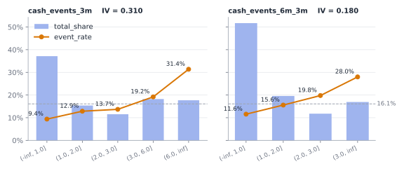</a>
      <br><b>时间窗特征</b>：最近三个月与此前三个月取现次数各区间的占比与事件率，由 <code>FeatureSpec</code> 从交易流水计算得出。
    </td>
  </tr>
  <tr>
    <td width="50%" valign="top">
      <a href="https://gchensy.github.io/kivi/zh/user_guide/woe_iv.html#charting-woe">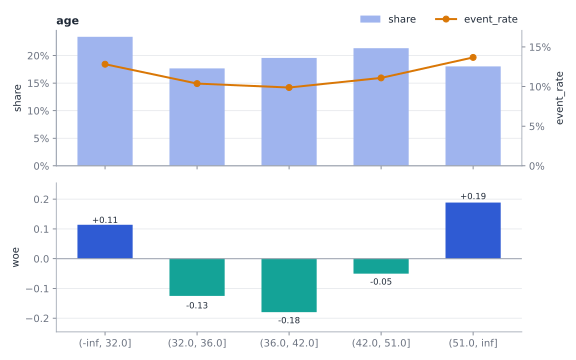</a>
      <br><b>WOE 图</b>：每箱的客户占比、事件率与 WOE。
    </td>
    <td width="50%" valign="top">
      <a href="https://gchensy.github.io/kivi/zh/user_guide/risk_workflow.html">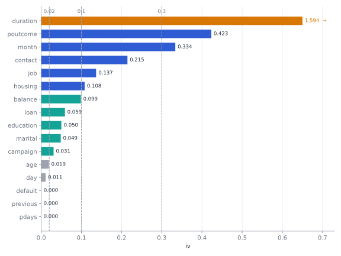</a>
      <br><b>变量筛选</b>：按 IV 排序并标出常用的解读区间；<code>duration</code> 存在信息泄漏。
    </td>
  </tr>
  <tr>
    <td colspan="2" valign="top">
      <a href="https://gchensy.github.io/kivi/zh/user_guide/psi.html#monitoring-over-time"></a>
      <br><b>模型监控</b>：各期相对开发样本的 PSI，附 0.1 与 0.25 阈值及样本量。
    </td>
  </tr>
  <tr>
    <td width="50%" valign="top">
      <a href="https://gchensy.github.io/kivi/zh/user_guide/metrics.html#gains-table">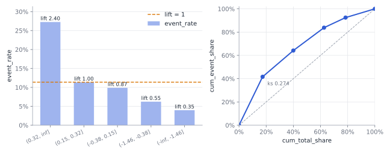</a>
      <br><b>增益</b>：各分数段的事件率与提升度，以及累计捕获的事件占比。
    </td>
    <td width="50%" valign="top">
      <a href="https://gchensy.github.io/kivi/zh/user_guide/vintage.html#vintage-curves">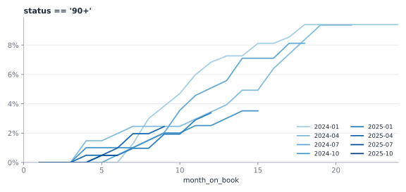</a>
      <br><b>Vintage 曲线</b>：各放款批次 90 天以上逾期的累计坏账率。
    </td>
  </tr>
  <tr>
    <td width="50%" valign="top">
      <a href="https://gchensy.github.io/kivi/zh/user_guide/strategy.html#swap-sets">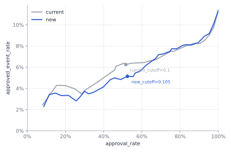</a>
      <br><b>截断点策略</b>：现行评分与新评分在各通过率下的通过客群坏账率。
    </td>
    <td width="50%" valign="top">
      <a href="https://gchensy.github.io/kivi/zh/user_guide/reject_inference.html#sensitivity-to-the-factor">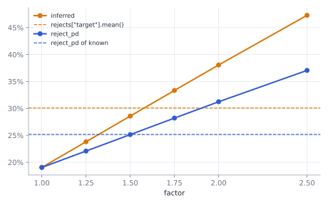</a>
      <br><b>拒绝推断</b>：不同 <code>factor</code> 下拒绝申请人的推断坏账率和重新拟合的 PD。
    </td>
  </tr>
  <tr>
    <td width="50%" valign="top">
      <a href="https://gchensy.github.io/kivi/zh/user_guide/monitoring.html#a-monitoring-report">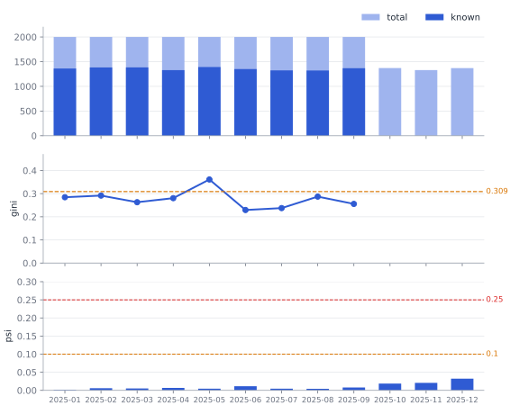</a>
      <br><b>模型监控</b>：评分每月的样本量、已知结果、Gini 和 PSI。
    </td>
    <td width="50%" valign="top">
      <a href="https://gchensy.github.io/kivi/zh/user_guide/lifetime.html#term-structures-from-vintage-curves">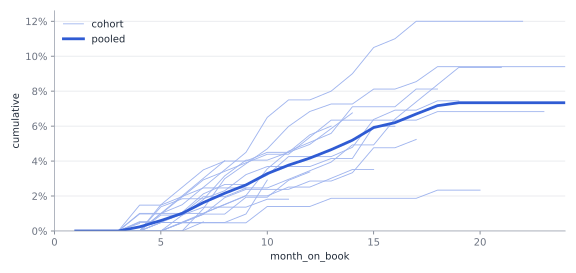</a>
      <br><b>存续期 PD</b>：各批次的累计 PD，以及用于预期信用损失的合并期限结构。
    </td>
  </tr>
  <tr>
    <td width="50%" valign="top">
      <a href="https://gchensy.github.io/kivi/zh/user_guide/capital.html#asset-classes">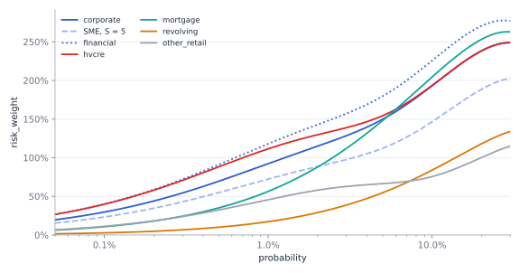</a>
      <br><b>监管资本</b>：各资产类别的内部评级法风险权重随 PD 的变化。
    </td>
    <td width="50%" valign="top">
      <a href="https://gchensy.github.io/kivi/zh/user_guide/lifetime.html#early-repayment-as-a-competing-risk">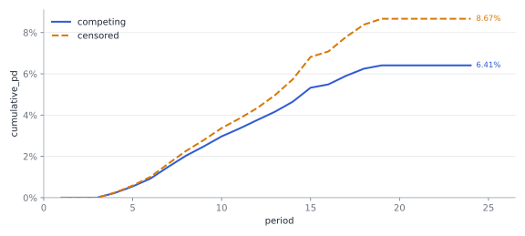</a>
      <br><b>生存曲线</b>：违约累计发生率与 1 − Kaplan–Meier 的对比；把已还清的贷款计为删失会高估违约。
    </td>
  </tr>
  <tr>
    <td width="50%" valign="top">
      <a href="https://gchensy.github.io/kivi/zh/user_guide/lgd.html#lgd-tables">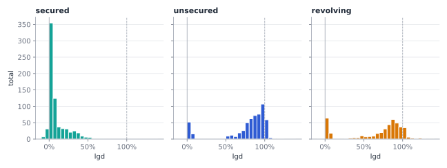</a>
      <br><b>实际 LGD</b>：已结案清收的 LGD 呈双峰分布，治愈的接近 0，无抵押贷款的清算接近 1。
    </td>
    <td width="50%" valign="top">
      <a href="https://gchensy.github.io/kivi/zh/user_guide/lgd.html#lgd-tables">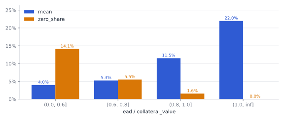</a>
      <br><b>LGD 的驱动因素</b>：由 <code>lgd_table</code> 得到的有抵押贷款按贷款价值比分段的平均 LGD。
    </td>
  </tr>
  <tr>
    <td width="50%" valign="top">
      <a href="https://gchensy.github.io/kivi/zh/user_guide/rules.html#decision-waterfall">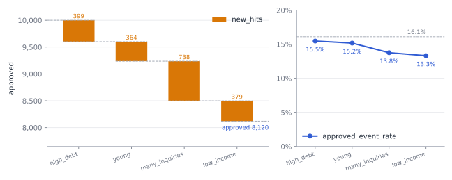</a>
      <br><b>政策规则</b>：四条规则的决策瀑布表，每条规则新增拒绝的申请人，以及剩余通过资产的事件率。
    </td>
    <td width="50%" valign="top">
      <a href="https://gchensy.github.io/kivi/zh/user_guide/strategy.html#revenue-and-profit">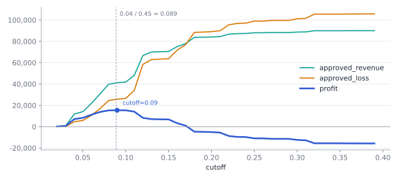</a>
      <br><b>各截断点的利润</b>：通过资产的收益、预期损失和利润，利润在盈亏平衡 PD 附近最高。
    </td>
  </tr>
</table>

## 🧭 工作流程

每一步都在开发样本上定义或拟合，再原样用于后续样本：

| 步骤 | 模块 | 主要函数 |
| --- | --- | --- |
| 计算特征 | `kivi.features` | `window_features`、`panel_features`、`FeatureSpec` |
| 分析候选变量 | `kivi.univariate` | `profile_table` |
| 分箱与编码 | `kivi.binning`、`kivi.woe` | `bin_edges`、`monotonic_edges`、`optimal_edges`、`chimerge_groups`、`woe_table`、`woe_trend`、`woe_transform` |
| 筛选与拟合 | `kivi.selection`、`kivi.reject_inference` | `vif_filter`、`selection_path`、`stepwise`、`logistic_regression`、`fuzzy_augmentation` |
| 刻度与评估 | `kivi.scorecard`、`kivi.metrics` | `points_table`、`roc_auc`、`roc_auc_interval`、`gains_table`、`expected_maximum_profit` |
| 校准 | `kivi.calibration` | `master_scale`、`assign_grades`、`jeffreys_test`、`central_tendency_shift` |
| 估计 LGD 与 EAD | `kivi.lgd`、`kivi.binning` | `workout_lgd`、`conversion_factor`、`variance_edges`、`lgd_table`、`fractional_regression` |
| 决策 | `kivi.strategy`、`kivi.rules` | `cutoff_table`、`confusion_table`、`swap_set`、`expected_loss_table`、`rule_candidates`、`rule_table`、`rule_set_table` |
| 部署与监控 | `kivi.spec`、`kivi.monitoring`、`kivi.stability` | `fit_spec`、`monitoring_table`、`stability_table`、`csi_table` |
| 验证 | `kivi.calibration`、`kivi.metrics`、`kivi.vintage` | `default_rate_table`、`backtest_table`、`generalized_auc`、`migration_test`、`concentration_test` |
| 计算资本 | `kivi.capital` | `capital_requirement`、`conditional_pd`、`vasicek_fit`、`most_prudent_pd` |
| 跟踪贷款 | `kivi.vintage`、`kivi.lifetime` | `delinquency_panel`、`vintage_table`、`survival_table`、`transition_pd`、`expected_credit_loss`、`assign_stages` |
| 绘制结果 | `kivi.plotting` | `woe_chart`、`roc_chart`、`precision_recall_chart`、`gains_chart`、`profit_chart`、`monitoring_chart`、`vintage_chart`、`survival_chart` |

前几步体现了这一模式：一次定义特征并为每个样本计算，拟合一次分箱边界并用它对每个样本分箱，再计算指标。

<p align="center">
  
</p>

## 📦 安装

```bash
pip install kivi
```

需要 Python 3.11+、NumPy 1.24+ 和 pandas 2.0+。如需最新开发版，可使用 `pip install "git+https://github.com/gchensy/kivi"`。

`kivi.plotting` 的图表还需要 matplotlib 3.7+，可用 `pip install "kivi[plot]"` 安装。

> **从 0.2.x 升级？** 0.3 的 API 有较大变化，升级已有代码前请先阅读[迁移指南](https://gchensy.github.io/kivi/zh/release/migration.html)。

## 🚀 快速上手

```python
import pandas as pd
from kivi.binning import bin_edges
from kivi.datasets import load_bank
from kivi.stability import psi_table
from kivi.woe import woe_table

data = load_bank()                              # 4,521 位银行营销客户
reference, current = data.iloc[:3000], data.iloc[3000:]

edges = bin_edges(reference["age"], bins=5)     # 1. 只在基准样本上拟合
before = pd.cut(reference["age"], edges)        # 2. 每个样本复用同一组边界
after = pd.cut(current["age"], edges)

evidence = woe_table(before, reference["target"])  # 3. 计算指标
stability = psi_table(before, after)

print(evidence[["event", "non_event", "woe", "iv"]].round(3))
print(f"IV = {evidence['iv'].sum():.3f}, PSI = {stability['psi'].sum():.4f}")
```

```text
              event  non_event    woe     iv
bin
(-inf, 32.0]     90        612  0.114  0.003
(32.0, 36.0]     55        475 -0.125  0.003
(36.0, 42.0]     58        529 -0.180  0.006
(42.0, 51.0]     71        569 -0.050  0.001
(51.0, inf]      74        467  0.189  0.007
IV = 0.019, PSI = 0.0024
```

类别变量无需边界，可直接传入标签，也可先用 `category_groups` 或 `chimerge_groups` 分组：

```python
jobs = woe_table(reference["job"], reference["target"])
print(f"IV(job) = {jobs['iv'].sum():.3f}")      # IV(job) = 0.137
```

## 🧰 API 一览

| 函数 | 用途 |
| --- | --- |
| [`kivi.features.window_features`](https://gchensy.github.io/kivi/zh/api/features.html#kivi.features.window_features) | 按截止于每个观察时间之前的月或天数窗口汇总交易等事件，时点正确：计数、求和、均值、极值、不同取值个数、距最近一次事件的天数和比率 |
| [`kivi.features.panel_features`](https://gchensy.github.io/kivi/zh/api/features.html#kivi.features.panel_features) | 汇总观察时间之前的月度还款状态：覆盖的月数、坏月数、连续坏月和连续好月的最长月数、最差状态以及距最近一个坏月的月数 |
| [`kivi.features.FeatureSpec`](https://gchensy.github.io/kivi/zh/api/features.html#kivi.features.FeatureSpec) | 时间窗特征和还款行为特征的定义，可在任何样本上重新计算，并保存为带版本号的 JSON |
| [`kivi.univariate.profile_table`](https://gchensy.github.io/kivi/zh/api/univariate.html#kivi.univariate.profile_table) | 每个候选变量一行：缺失值、分布及其形态、事件率、快速分箱的 IV 与卡方检验，以及数值变量的 Gini 和 KS |
| [`kivi.binning.bin_edges`](https://gchensy.github.io/kivi/zh/api/binning.html#kivi.binning.bin_edges) | 在基准样本上拟合等频或等距边界，两端边界为无穷 |
| [`kivi.binning.cut`](https://gchensy.github.io/kivi/zh/api/binning.html#kivi.binning.cut) | 把取值分配到各箱，`-1` 等特殊值各自单独成组 |
| [`kivi.binning.chimerge_edges`](https://gchensy.github.io/kivi/zh/api/binning.html#kivi.binning.chimerge_edges) | 用 ChiMerge 合并等频细分箱，直到相邻箱差异显著，并可限制每箱的最小占比 |
| [`kivi.binning.tree_edges`](https://gchensy.github.io/kivi/zh/api/binning.html#kivi.binning.tree_edges) | 按熵或 Gini 的决策树切分，并限制每箱的最小占比 |
| [`kivi.binning.ks_edges`](https://gchensy.github.io/kivi/zh/api/binning.html#kivi.binning.ks_edges) | Best-KS 分箱：在事件与非事件累计占比相差最大处切分，并限制每箱的最小占比 |
| [`kivi.binning.monotonic_edges`](https://gchensy.github.io/kivi/zh/api/binning.html#kivi.binning.monotonic_edges) | 合并等频细分箱，直到 WOE 单调，并可限制每箱的最小占比 |
| [`kivi.binning.optimal_edges`](https://gchensy.github.io/kivi/zh/api/binning.html#kivi.binning.optimal_edges) | 在每箱的最小占比、最少事件数和非事件数，以及 WOE 单调上升、单调下降、U 形或倒 U 形的约束下，精确求出 IV 最大的等频细分箱合并方式 |
| [`kivi.binning.variance_edges`](https://gchensy.github.io/kivi/zh/api/binning.html#kivi.binning.variance_edges) | 按连续型响应（如实际 LGD 或 CCF）为驱动变量分箱，使各箱均值区分得最好：在每箱最小占比和箱均值趋势的约束下，精确求出箱内平方和最小的分箱 |
| [`kivi.binning.category_groups`](https://gchensy.github.io/kivi/zh/api/binning.html#kivi.binning.category_groups), [`kivi.binning.chimerge_groups`](https://gchensy.github.io/kivi/zh/api/binning.html#kivi.binning.chimerge_groups), [`kivi.binning.group_categories`](https://gchensy.github.io/kivi/zh/api/binning.html#kivi.binning.group_categories) | 类别变量的分组：合并稀有类别或事件率相近的类别，再把分组用于每个样本 |
| [`kivi.woe.woe_table`](https://gchensy.github.io/kivi/zh/api/woe.html#kivi.woe.woe_table) | 每组的计数、占比、WOE 与 IV |
| [`kivi.woe.woe_transform`](https://gchensy.github.io/kivi/zh/api/woe.html#kivi.woe.woe_transform) | 用开发样本的 WOE 替换每个分组，未见过的分组需明确处理方式 |
| [`kivi.woe.woe_trend`](https://gchensy.github.io/kivi/zh/api/woe.html#kivi.woe.woe_trend) | 给出数值变量各箱 WOE 的趋势形状：单调上升、单调下降、U 形、倒 U 形、不规则或平坦 |
| [`kivi.woe.woe`](https://gchensy.github.io/kivi/zh/api/woe.html#kivi.woe.woe), [`kivi.woe.iv`](https://gchensy.github.io/kivi/zh/api/woe.html#kivi.woe.iv), [`kivi.stability.psi`](https://gchensy.github.io/kivi/zh/api/stability.html#kivi.stability.psi) | 直接从已汇总的计数计算 WOE、IV 和 PSI |
| [`kivi.selection.correlation_filter`](https://gchensy.github.io/kivi/zh/api/selection.html#kivi.selection.correlation_filter), [`kivi.selection.vif`](https://gchensy.github.io/kivi/zh/api/selection.html#kivi.selection.vif), [`kivi.selection.vif_filter`](https://gchensy.github.io/kivi/zh/api/selection.html#kivi.selection.vif_filter) | 按 IV 剔除高度相关的变量（Pearson 或 Spearman 相关），计算方差膨胀因子，并逐个剔除 VIF 最大的变量，直到没有 VIF 超过阈值 |
| [`kivi.selection.logistic_regression`](https://gchensy.github.io/kivi/zh/api/selection.html#kivi.selection.logistic_regression), [`kivi.selection.stepwise`](https://gchensy.github.io/kivi/zh/api/selection.html#kivi.selection.stepwise) | 基于 NumPy 的逻辑回归，以及保证系数全为正的逐步回归，支持频数权重 |
| [`kivi.selection.selection_path`](https://gchensy.github.io/kivi/zh/api/selection.html#kivi.selection.selection_path) | 依次用某个顺序（例如按 IV）的前 1 个、前 2 个、前 3 个……变量拟合模型，给出每个模型的 AUC、Gini、KS、最大 p 值和最小系数，也可在验证样本上计算 |
| [`kivi.reject_inference.fuzzy_augmentation`](https://gchensy.github.io/kivi/zh/api/reject_inference.html#kivi.reject_inference.fuzzy_augmentation), [`kivi.reject_inference.parceling`](https://gchensy.github.io/kivi/zh/api/reject_inference.html#kivi.reject_inference.parceling), [`kivi.reject_inference.reweighting`](https://gchensy.github.io/kivi/zh/api/reject_inference.html#kivi.reject_inference.reweighting) | 推断被拒绝申请人的结果，以带权重的行或获批申请人的权重给出 |
| [`kivi.scorecard.score_scaling`](https://gchensy.github.io/kivi/zh/api/scorecard.html#kivi.scorecard.score_scaling), [`kivi.scorecard.pd_to_score`](https://gchensy.github.io/kivi/zh/api/scorecard.html#kivi.scorecard.pd_to_score), [`kivi.scorecard.score_to_pd`](https://gchensy.github.io/kivi/zh/api/scorecard.html#kivi.scorecard.score_to_pd) | PDO 刻度的因子与偏移量，以及 PD 与分数互相换算 |
| [`kivi.scorecard.points_table`](https://gchensy.github.io/kivi/zh/api/scorecard.html#kivi.scorecard.points_table), [`kivi.scorecard.woe_to_points`](https://gchensy.github.io/kivi/zh/api/scorecard.html#kivi.scorecard.woe_to_points), [`kivi.scorecard.reason_codes`](https://gchensy.github.io/kivi/zh/api/scorecard.html#kivi.scorecard.reason_codes) | 按 PDO 刻度计算每组分值、为新数据打分并给出原因码 |
| [`kivi.expert.ahp_weights`](https://gchensy.github.io/kivi/zh/api/expert.html#kivi.expert.ahp_weights), [`kivi.expert.ahp_consistency`](https://gchensy.github.io/kivi/zh/api/expert.html#kivi.expert.ahp_consistency) | 由两两比较矩阵确定专家评分卡各因子的权重（主特征向量法或行几何平均法），并给出各项判断的一致性比率 |
| [`kivi.expert.combine_weights`](https://gchensy.github.io/kivi/zh/api/expert.html#kivi.expert.combine_weights) | 子因子的全局权重：各因子的权重乘以其子因子的权重 |
| [`kivi.metrics.roc_auc`](https://gchensy.github.io/kivi/zh/api/metrics.html#kivi.metrics.roc_auc), [`kivi.metrics.gini`](https://gchensy.github.io/kivi/zh/api/metrics.html#kivi.metrics.gini), [`kivi.metrics.ks`](https://gchensy.github.io/kivi/zh/api/metrics.html#kivi.metrics.ks), [`kivi.metrics.brier_score`](https://gchensy.github.io/kivi/zh/api/metrics.html#kivi.metrics.brier_score) | 分数或 PD 相对二分类目标的 AUC、Gini、KS 和 Brier 分数 |
| [`kivi.metrics.gains_table`](https://gchensy.github.io/kivi/zh/api/metrics.html#kivi.metrics.gains_table) | 按分数段统计的增益与提升，含累计捕获率和 KS |
| [`kivi.metrics.roc_table`](https://gchensy.github.io/kivi/zh/api/metrics.html#kivi.metrics.roc_table), [`kivi.metrics.roc_auc_interval`](https://gchensy.github.io/kivi/zh/api/metrics.html#kivi.metrics.roc_auc_interval), [`kivi.metrics.delong_test`](https://gchensy.github.io/kivi/zh/api/metrics.html#kivi.metrics.delong_test) | 每个阈值一行的 ROC 曲线表、AUC 与 Gini 的 DeLong 置信区间，以及两个评分的 DeLong 检验 |
| [`kivi.metrics.generalized_auc`](https://gchensy.github.io/kivi/zh/api/metrics.html#kivi.metrics.generalized_auc) | 估计分段相对实际分段（例如 LGD 模型的等级与实际 LGD）的广义 AUC 和 Somers' D，以及它们的标准误 |
| [`kivi.metrics.expected_maximum_profit`](https://gchensy.github.io/kivi/zh/api/metrics.html#kivi.metrics.expected_maximum_profit) | 信用评分的期望最大利润（EMP）：在不确定的违约损失上平均的最优截断点每位申请人利润，以及该截断点拒绝的申请人占比 |
| [`kivi.calibration.master_scale`](https://gchensy.github.io/kivi/zh/api/calibration.html#kivi.calibration.master_scale), [`kivi.calibration.fit_grade_pd`](https://gchensy.github.io/kivi/zh/api/calibration.html#kivi.calibration.fit_grade_pd), [`kivi.calibration.assign_grades`](https://gchensy.github.io/kivi/zh/api/calibration.html#kivi.calibration.assign_grades) | 由各等级的 PD 构建主标尺或按违约率拟合主标尺，并为每个 PD 分配等级 |
| [`kivi.calibration.calibration_table`](https://gchensy.github.io/kivi/zh/api/calibration.html#kivi.calibration.calibration_table), [`kivi.calibration.binomial_test`](https://gchensy.github.io/kivi/zh/api/calibration.html#kivi.calibration.binomial_test), [`kivi.calibration.jeffreys_test`](https://gchensy.github.io/kivi/zh/api/calibration.html#kivi.calibration.jeffreys_test), [`kivi.calibration.hosmer_lemeshow`](https://gchensy.github.io/kivi/zh/api/calibration.html#kivi.calibration.hosmer_lemeshow) | 按评级比较事件率与预测 PD，并做二项、Jeffreys 和 Hosmer-Lemeshow 检验 |
| [`kivi.calibration.spiegelhalter_test`](https://gchensy.github.io/kivi/zh/api/calibration.html#kivi.calibration.spiegelhalter_test), [`kivi.calibration.brier_decomposition`](https://gchensy.github.io/kivi/zh/api/calibration.html#kivi.calibration.brier_decomposition) | 对单个观测的 PD 做 Spiegelhalter 检验，并把 Brier 分数分解为可靠性、分辨力和不确定性 |
| [`kivi.calibration.backtest_table`](https://gchensy.github.io/kivi/zh/api/calibration.html#kivi.calibration.backtest_table) | 按等级用欧洲央行的 t 检验以实际值回测 LGD、ELBE、CCF 等连续型估计值 |
| [`kivi.calibration.prior_correction`](https://gchensy.github.io/kivi/zh/api/calibration.html#kivi.calibration.prior_correction), [`kivi.calibration.corrected_intercept`](https://gchensy.github.io/kivi/zh/api/calibration.html#kivi.calibration.corrected_intercept) | 对过采样样本校正 PD 和模型截距 |
| [`kivi.calibration.herfindahl_index`](https://gchensy.github.io/kivi/zh/api/calibration.html#kivi.calibration.herfindahl_index), [`kivi.calibration.concentration_test`](https://gchensy.github.io/kivi/zh/api/calibration.html#kivi.calibration.concentration_test) | 等级的集中度：赫芬达尔-赫希曼指数，以及欧洲央行的 HI 及其相对初始验证的检验 |
| [`kivi.calibration.platt_fit`](https://gchensy.github.io/kivi/zh/api/calibration.html#kivi.calibration.platt_fit), [`kivi.calibration.platt_predict`](https://gchensy.github.io/kivi/zh/api/calibration.html#kivi.calibration.platt_predict), [`kivi.calibration.isotonic_fit`](https://gchensy.github.io/kivi/zh/api/calibration.html#kivi.calibration.isotonic_fit), [`kivi.calibration.isotonic_predict`](https://gchensy.github.io/kivi/zh/api/calibration.html#kivi.calibration.isotonic_predict) | 用 Platt 缩放或保序回归把分数重新校准为概率 |
| [`kivi.calibration.central_tendency_shift`](https://gchensy.github.io/kivi/zh/api/calibration.html#kivi.calibration.central_tendency_shift), [`kivi.calibration.quasi_moment_fit`](https://gchensy.github.io/kivi/zh/api/calibration.html#kivi.calibration.quasi_moment_fit) | 把 PD 校准到中心趋势（如长期平均违约率）：平移其 log odds，或用准矩匹配按中心趋势和准确性比率拟合 logistic PD 曲线 |
| [`kivi.lgd.workout_lgd`](https://gchensy.github.io/kivi/zh/api/lgd.html#kivi.lgd.workout_lgd) | 由清收现金流计算每笔违约贷款的实际 LGD：按每笔贷款的利率折现到违约日，违约前的费用复利到违约日，结果不截断 |
| [`kivi.lgd.conversion_factor`](https://gchensy.github.io/kivi/zh/api/lgd.html#kivi.lgd.conversion_factor) | 由参考日的额度和已提用金额计算每个信用额度的实际 CCF，满额使用的额度为 NaN |
| [`kivi.lgd.lgd_table`](https://gchensy.github.io/kivi/zh/api/lgd.html#kivi.lgd.lgd_table), [`kivi.lgd.fractional_regression`](https://gchensy.github.io/kivi/zh/api/lgd.html#kivi.lgd.fractional_regression) | 按组汇总 LGD（按监管的平均方式把负值记为 0），以及对 0 到 1 之间的响应做分数 logit 回归并给出稳健标准误 |
| [`kivi.strategy.cutoff_table`](https://gchensy.github.io/kivi/zh/api/strategy.html#kivi.strategy.cutoff_table), [`kivi.strategy.swap_set`](https://gchensy.github.io/kivi/zh/api/strategy.html#kivi.strategy.swap_set), [`kivi.strategy.confusion_table`](https://gchensy.github.io/kivi/zh/api/strategy.html#kivi.strategy.confusion_table) | 每个截断点的通过率与坏账率、通过资产的收益、损失与利润、混淆矩阵、精确率、召回率与 F1，以及现行评分与新评分之间的交换集 |
| [`kivi.strategy.expected_loss`](https://gchensy.github.io/kivi/zh/api/strategy.html#kivi.strategy.expected_loss), [`kivi.strategy.expected_loss_table`](https://gchensy.github.io/kivi/zh/api/strategy.html#kivi.strategy.expected_loss_table) | 每笔敞口及各等级的预期损失 PD × LGD × EAD |
| [`kivi.rules.rule_candidates`](https://gchensy.github.io/kivi/zh/api/rules.html#kivi.rules.rule_candidates) | 用决策树或 Best-KS 的切点在数值变量中搜索单阈值政策规则，并给出每条规则的命中、事件率和提升度 |
| [`kivi.rules.rule_table`](https://gchensy.github.io/kivi/zh/api/rules.html#kivi.rules.rule_table), [`kivi.rules.rule_set_table`](https://gchensy.github.io/kivi/zh/api/rules.html#kivi.rules.rule_set_table) | 每条政策规则的命中、事件率、提升度、召回率与独有命中，以及规则集的决策瀑布表和它留下的通过资产 |
| [`kivi.spec.fit_spec`](https://gchensy.github.io/kivi/zh/api/spec.html#kivi.spec.fit_spec), [`kivi.spec.BinningSpec`](https://gchensy.github.io/kivi/zh/api/spec.html#kivi.spec.BinningSpec) | 对整个数据框分箱并做 WOE 编码，把分箱方案保存为带版本号的 JSON |
| [`kivi.stability.psi_table`](https://gchensy.github.io/kivi/zh/api/stability.html#kivi.stability.psi_table) | 两个样本逐组的 PSI 贡献 |
| [`kivi.stability.csi_table`](https://gchensy.github.io/kivi/zh/api/stability.html#kivi.stability.csi_table) | 特征稳定性指数（CSI）：各变量的分布变化让平均分移动了多少 |
| [`kivi.monitoring.monitoring_table`](https://gchensy.github.io/kivi/zh/api/monitoring.html#kivi.monitoring.monitoring_table), [`kivi.monitoring.stability_table`](https://gchensy.github.io/kivi/zh/api/monitoring.html#kivi.monitoring.stability_table) | 每期一行：样本量、已知结果、AUC、Gini、KS 和评分的 PSI；以及各变量在每期的 PSI |
| [`kivi.capital.asset_correlation`](https://gchensy.github.io/kivi/zh/api/capital.html#kivi.capital.asset_correlation), [`kivi.capital.capital_requirement`](https://gchensy.github.io/kivi/zh/api/capital.html#kivi.capital.capital_requirement) | 巴塞尔框架和中国 2023 年规则下内部评级法的资本要求，适用于公司、高波动性商业房地产、住房抵押、循环零售和其他零售敞口，包括中小企业、金融机构和期限调整 |
| [`kivi.capital.conditional_pd`](https://gchensy.github.io/kivi/zh/api/capital.html#kivi.capital.conditional_pd), [`kivi.capital.systematic_factor`](https://gchensy.github.io/kivi/zh/api/capital.html#kivi.capital.systematic_factor), [`kivi.capital.vasicek_fit`](https://gchensy.github.io/kivi/zh/api/capital.html#kivi.capital.vasicek_fit) | Vasicek 单因子模型：某种经济情景下的 PD、违约率所对应的系统因子，以及由一组违约率估计的长期 PD 和资产相关系数 |
| [`kivi.capital.most_prudent_pd`](https://gchensy.github.io/kivi/zh/api/capital.html#kivi.capital.most_prudent_pd) | Pluto 和 Tasche 的最审慎估计：违约很少或没有违约的组合中各等级 PD 的上界，违约可相互独立或相关 |
| [`kivi.vintage.delinquency_panel`](https://gchensy.github.io/kivi/zh/api/vintage.html#kivi.vintage.delinquency_panel) | 根据还款计划和还款记录构建月度逾期面板：逾期天数、状态、逾期金额和未还金额 |
| [`kivi.vintage.vintage_table`](https://gchensy.github.io/kivi/zh/api/vintage.html#kivi.vintage.vintage_table) | 各放款批次按账龄（月）的累计坏账率 |
| [`kivi.vintage.default_rate_table`](https://gchensy.github.io/kivi/zh/api/vintage.html#kivi.vintage.default_rate_table) | 按队列法统计各起点月每个等级的一年违约率，以及一年内离开的贷款数和每个队列的平均 PD |
| [`kivi.vintage.transition_matrix`](https://gchensy.github.io/kivi/zh/api/vintage.html#kivi.vintage.transition_matrix), [`kivi.vintage.roll_rates`](https://gchensy.github.io/kivi/zh/api/vintage.html#kivi.vintage.roll_rates) | 逾期档位之间的迁移，以及每个档位向下一档的滚动率 |
| [`kivi.vintage.migration_bandwidth`](https://gchensy.github.io/kivi/zh/api/vintage.html#kivi.vintage.migration_bandwidth), [`kivi.vintage.migration_test`](https://gchensy.github.io/kivi/zh/api/vintage.html#kivi.vintage.migration_test) | 评级等级之间的迁移：按欧洲央行要求给出上、下矩阵加权带宽，并对每个非对角单元格做 z 检验 |
| [`kivi.lifetime.convert_pd`](https://gchensy.github.io/kivi/zh/api/lifetime.html#kivi.lifetime.convert_pd), [`kivi.lifetime.transition_pd`](https://gchensy.github.io/kivi/zh/api/lifetime.html#kivi.lifetime.transition_pd) | 在累计、边际和条件 PD 之间转换 PD 期限结构，并由转移矩阵推算期限结构 |
| [`kivi.lifetime.survival_table`](https://gchensy.github.io/kivi/zh/api/lifetime.html#kivi.lifetime.survival_table) | 由存在删失、提前还款或只从某一账龄起才被观测到的贷款估计 Kaplan–Meier 和 Aalen–Johansen 期限结构，并给出每期处于风险中的贷款数和风险率 |
| [`kivi.lifetime.expected_credit_loss`](https://gchensy.github.io/kivi/zh/api/lifetime.html#kivi.lifetime.expected_credit_loss), [`kivi.lifetime.significant_increase`](https://gchensy.github.io/kivi/zh/api/lifetime.html#kivi.lifetime.significant_increase), [`kivi.lifetime.assign_stages`](https://gchensy.github.io/kivi/zh/api/lifetime.html#kivi.lifetime.assign_stages), [`kivi.lifetime.stage_table`](https://gchensy.github.io/kivi/zh/api/lifetime.html#kivi.lifetime.stage_table) | IFRS 9：12 个月与整个存续期的预期信用损失、信用风险显著增加、第 1 至 3 阶段以及各阶段的损失准备 |
| [`kivi.plotting.woe_chart`](https://gchensy.github.io/kivi/zh/api/plotting.html#kivi.plotting.woe_chart), [`kivi.plotting.psi_chart`](https://gchensy.github.io/kivi/zh/api/plotting.html#kivi.plotting.psi_chart), [`kivi.plotting.correlation_chart`](https://gchensy.github.io/kivi/zh/api/plotting.html#kivi.plotting.correlation_chart) | 变量的图表：各分箱的 WOE 与事件率、基准与当前占比，以及相关性热力图 |
| [`kivi.plotting.roc_chart`](https://gchensy.github.io/kivi/zh/api/plotting.html#kivi.plotting.roc_chart), [`kivi.plotting.precision_recall_chart`](https://gchensy.github.io/kivi/zh/api/plotting.html#kivi.plotting.precision_recall_chart), [`kivi.plotting.gains_chart`](https://gchensy.github.io/kivi/zh/api/plotting.html#kivi.plotting.gains_chart), [`kivi.plotting.distribution_chart`](https://gchensy.github.io/kivi/zh/api/plotting.html#kivi.plotting.distribution_chart), [`kivi.plotting.calibration_chart`](https://gchensy.github.io/kivi/zh/api/plotting.html#kivi.plotting.calibration_chart), [`kivi.plotting.cutoff_chart`](https://gchensy.github.io/kivi/zh/api/plotting.html#kivi.plotting.cutoff_chart), [`kivi.plotting.monitoring_chart`](https://gchensy.github.io/kivi/zh/api/plotting.html#kivi.plotting.monitoring_chart), [`kivi.plotting.vintage_chart`](https://gchensy.github.io/kivi/zh/api/plotting.html#kivi.plotting.vintage_chart) | 评分与组合的图表：带 KS 的 ROC、精确率-召回率与增益曲线、各分段的事件与非事件占比、校准、截断点、逐期监控和 vintage 曲线 |
| [`kivi.plotting.survival_chart`](https://gchensy.github.io/kivi/zh/api/plotting.html#kivi.plotting.survival_chart), [`kivi.plotting.transition_chart`](https://gchensy.github.io/kivi/zh/api/plotting.html#kivi.plotting.transition_chart), [`kivi.plotting.rule_set_chart`](https://gchensy.github.io/kivi/zh/api/plotting.html#kivi.plotting.rule_set_chart), [`kivi.plotting.profit_chart`](https://gchensy.github.io/kivi/zh/api/plotting.html#kivi.plotting.profit_chart), [`kivi.plotting.lgd_chart`](https://gchensy.github.io/kivi/zh/api/plotting.html#kivi.plotting.lgd_chart) | 贷款与决策的图表：含竞争风险的生存曲线、转移矩阵热力图、规则集的决策瀑布、各截断点的利润，以及各分组 LGD 的均值、零损失和全额损失占比 |
| [`kivi.datasets.load_bank`](https://gchensy.github.io/kivi/zh/api/datasets.html#kivi.datasets.load_bank), [`kivi.datasets.make_loan_panel`](https://gchensy.github.io/kivi/zh/api/datasets.html#kivi.datasets.make_loan_panel), [`kivi.datasets.make_applications`](https://gchensy.github.io/kivi/zh/api/datasets.html#kivi.datasets.make_applications), [`kivi.datasets.make_transactions`](https://gchensy.github.io/kivi/zh/api/datasets.html#kivi.datasets.make_transactions), [`kivi.datasets.make_defaults`](https://gchensy.github.io/kivi/zh/api/datasets.html#kivi.datasets.make_defaults), [`kivi.datasets.make_recoveries`](https://gchensy.github.io/kivi/zh/api/datasets.html#kivi.datasets.make_recoveries) | 随包的银行营销数据，以及按种子生成的合成贷款面板、贷款申请数据、每笔申请之前的账户交易流水，以及违约贷款及其清收现金流 |

## 📚 文档

| | 中文 | English |
| --- | --- | --- |
| 快速上手 | [阅读](https://gchensy.github.io/kivi/zh/getting_started/quickstart.html) | [Read](https://gchensy.github.io/kivi/en/getting_started/quickstart.html) |
| 教程：分十一章展开的信用评分卡项目 | [阅读](https://gchensy.github.io/kivi/zh/tutorial/index.html) | [Read](https://gchensy.github.io/kivi/en/tutorial/index.html) |
| 风控建模流程 | [阅读](https://gchensy.github.io/kivi/zh/user_guide/risk_workflow.html) | [Read](https://gchensy.github.io/kivi/en/user_guide/risk_workflow.html) |
| 时间窗特征 | [阅读](https://gchensy.github.io/kivi/zh/user_guide/features.html) | [Read](https://gchensy.github.io/kivi/en/user_guide/features.html) |
| 单变量概况 | [阅读](https://gchensy.github.io/kivi/zh/user_guide/univariate.html) | [Read](https://gchensy.github.io/kivi/en/user_guide/univariate.html) |
| 分箱 | [阅读](https://gchensy.github.io/kivi/zh/user_guide/binning.html) | [Read](https://gchensy.github.io/kivi/en/user_guide/binning.html) |
| WOE 与 IV | [阅读](https://gchensy.github.io/kivi/zh/user_guide/woe_iv.html) | [Read](https://gchensy.github.io/kivi/en/user_guide/woe_iv.html) |
| 变量筛选 | [阅读](https://gchensy.github.io/kivi/zh/user_guide/selection.html) | [Read](https://gchensy.github.io/kivi/en/user_guide/selection.html) |
| 拒绝推断 | [阅读](https://gchensy.github.io/kivi/zh/user_guide/reject_inference.html) | [Read](https://gchensy.github.io/kivi/en/user_guide/reject_inference.html) |
| 评分卡 | [阅读](https://gchensy.github.io/kivi/zh/user_guide/scorecard.html) | [Read](https://gchensy.github.io/kivi/en/user_guide/scorecard.html) |
| 专家评分卡 | [阅读](https://gchensy.github.io/kivi/zh/user_guide/expert.html) | [Read](https://gchensy.github.io/kivi/en/user_guide/expert.html) |
| 模型表现 | [阅读](https://gchensy.github.io/kivi/zh/user_guide/metrics.html) | [Read](https://gchensy.github.io/kivi/en/user_guide/metrics.html) |
| 校准 | [阅读](https://gchensy.github.io/kivi/zh/user_guide/calibration.html) | [Read](https://gchensy.github.io/kivi/en/user_guide/calibration.html) |
| LGD 与 EAD | [阅读](https://gchensy.github.io/kivi/zh/user_guide/lgd.html) | [Read](https://gchensy.github.io/kivi/en/user_guide/lgd.html) |
| 信贷策略 | [阅读](https://gchensy.github.io/kivi/zh/user_guide/strategy.html) | [Read](https://gchensy.github.io/kivi/en/user_guide/strategy.html) |
| 政策规则 | [阅读](https://gchensy.github.io/kivi/zh/user_guide/rules.html) | [Read](https://gchensy.github.io/kivi/en/user_guide/rules.html) |
| 分箱方案 | [阅读](https://gchensy.github.io/kivi/zh/user_guide/spec.html) | [Read](https://gchensy.github.io/kivi/en/user_guide/spec.html) |
| PSI | [阅读](https://gchensy.github.io/kivi/zh/user_guide/psi.html) | [Read](https://gchensy.github.io/kivi/en/user_guide/psi.html) |
| 模型监控 | [阅读](https://gchensy.github.io/kivi/zh/user_guide/monitoring.html) | [Read](https://gchensy.github.io/kivi/en/user_guide/monitoring.html) |
| 模型验证 | [阅读](https://gchensy.github.io/kivi/zh/user_guide/validation.html) | [Read](https://gchensy.github.io/kivi/en/user_guide/validation.html) |
| 监管资本 | [阅读](https://gchensy.github.io/kivi/zh/user_guide/capital.html) | [Read](https://gchensy.github.io/kivi/en/user_guide/capital.html) |
| Vintage 与滚动率分析 | [阅读](https://gchensy.github.io/kivi/zh/user_guide/vintage.html) | [Read](https://gchensy.github.io/kivi/en/user_guide/vintage.html) |
| 存续期 PD 与预期信用损失 | [阅读](https://gchensy.github.io/kivi/zh/user_guide/lifetime.html) | [Read](https://gchensy.github.io/kivi/en/user_guide/lifetime.html) |
| 图表 | [阅读](https://gchensy.github.io/kivi/zh/user_guide/plotting.html) | [Read](https://gchensy.github.io/kivi/en/user_guide/plotting.html) |
| 示例数据 | [阅读](https://gchensy.github.io/kivi/zh/user_guide/datasets.html) | [Read](https://gchensy.github.io/kivi/en/user_guide/datasets.html) |
| 约定 | [阅读](https://gchensy.github.io/kivi/zh/api/conventions.html) | [Read](https://gchensy.github.io/kivi/en/api/conventions.html) |
| 兼容性 | [阅读](https://gchensy.github.io/kivi/zh/api/compatibility.html) | [Read](https://gchensy.github.io/kivi/en/api/compatibility.html) |
| 术语表 | [阅读](https://gchensy.github.io/kivi/zh/api/glossary.html) | [Read](https://gchensy.github.io/kivi/en/api/glossary.html) |
| 迁移指南 | [阅读](https://gchensy.github.io/kivi/zh/release/migration.html) | [Read](https://gchensy.github.io/kivi/en/release/migration.html) |

## 🗺️ 路线图

- ✅ 基于 pandas 核心的等频与等距分箱、WOE、IV 和 PSI
- ✅ 中英文文档，示例经过测试
- ✅ `-1`、`-999` 等特殊值单独分箱
- ✅ 带图表的风控示例：特殊值、粗分箱、IV 筛选、PSI 监控
- ✅ 有监督分箱：ChiMerge、决策树与单调 WOE
- ✅ 新数据的 WOE 编码，未见过的分组需明确处理方式
- ✅ 分箱、WOE 和 PSI 支持样本权重
- ✅ 评分卡流程：变量筛选、逻辑回归、PDO 刻度、原因码、模型评估与校准
- ✅ CSI、账龄（vintage）与滚动率分析，批量分箱并保存分箱规格
- ✅ Platt 与保序回归校准，评估指标支持样本权重
- ✅ 信贷策略：截断点表、交换集与预期损失
- ✅ 拒绝推断，以及带权重的模型拟合
- ✅ 主标尺与单变量概况表
- ✅ 各主题指南采用统一的结构，新增约定页和术语表
- ✅ 类别分组、ROC 表与 AUC 的 DeLong 检验
- ✅ 逐期的模型监控
- ✅ 存续期 PD 期限结构、IFRS 9 预期信用损失与阶段划分
- ✅ 在 CI 中检查类型标注、测试覆盖率，以及 API 审查：0.9 的弃用与面向 1.0 的兼容性承诺
- ✅ 1.0：稳定的 API，采用语义化版本，移除 0.9 中弃用的内容
- ✅ 展示 kivi 如何计算结果的示意图，以及贯穿一个信用风险项目的教程
- ✅ 1.1：所有结果表的图表（`kivi[plot]`）、截断点的混淆矩阵与 F1、单变量概况中的形态统计量、KS 与卡方检验、Spearman 相关筛选，以及在 CI 中与 scikit-learn、SciPy 和 statsmodels 的交叉验证
- ✅ 1.2：Best-KS 分箱、由还款计划和还款记录构建逾期面板，以及用层次分析法确定专家评分卡的权重并检验其一致性
- ✅ 1.3：交易等事件的时点正确的时间窗特征、由月度状态面板计算的还款行为特征、保存为带版本号 JSON 的特征方案，以及每笔申请之前的模拟交易流水
- ✅ 1.4：欧洲央行对 PD、LGD 和 CCF 模型的验证检验（迁移带宽与迁移检验、集中度检验、连续型估计值的回测和广义 AUC）、Spiegelhalter 检验与 Brier 分数分解、按 VIF 逐步剔除变量与变量选择路径、精确率-召回率图与分布图，以及 WOE 趋势标签
- ✅ 1.5：监管资本（巴塞尔框架和中国 2023 年规则的内部评级法风险权重函数、Vasicek 单因子模型、低违约组合的 Pluto-Tasche 估计）、用于存续期 PD 的含竞争风险和左截断的生存曲线、含提前还款的贷款面板，以及多种经济情景下的预期信用损失
- ✅ 1.6：LGD 与 EAD：按每笔贷款折现的清收 LGD、实际信用转换系数、分组 LGD 表、带稳健标准误的分数 logit、模拟的违约与回收数据，以及并列给出的巴塞尔、EBA 和中国规则
- ✅ 1.7：政策规则与利润：政策规则的命中率、独有命中和决策瀑布表，也可只在通过的申请人上衡量；各截断点的收益与利润；以及信用评分的期望最大利润
- ✅ 1.8：在每箱占比、事件数和 WOE 形状（含 U 形）的约束下求 IV 最大的分箱，对 LGD 等连续型响应同样精确的分箱，ChiMerge 和单调分箱的每箱最小占比，单阈值政策规则的搜索，按队列法计算的一年违约率，用 log odds 平移或准矩匹配校准到长期平均违约率，以及生存曲线、转移矩阵、决策瀑布、各截断点利润和分组 LGD 的图表
- ✅ 1.9：要求 Python 3.11 或更新版本，NumPy 1.24 和 pandas 2.0 仍受支持

## 🤝 参与贡献

```bash
git clone https://github.com/gchensy/kivi.git
cd kivi
python -m pip install -e '.[test,docs,lint]'              # 安装 kivi 及测试、文档和代码检查工具
pre-commit install                                        # 每次提交前运行 ruff 和 mypy
python -m pytest --cov                                    # 单元测试，并统计分支覆盖率
python -m sphinx -W -b doctest docs docs/_build/doctest   # 文档示例
python docs/build.py                                      # 中英文 HTML 文档
```

修改英文文档或 docstring 后，运行 `python docs/build.py --update-po`，并补全 `docs/locale/zh_CN/LC_MESSAGES/kivi.po` 中的新条目。翻译步骤和文档约定见[编写文档](https://gchensy.github.io/kivi/zh/development/documentation.html)，每个拉取请求都要通过的检查见[开发指南](https://gchensy.github.io/kivi/zh/development/index.html)。

## 📄 许可

源代码采用 [MIT 许可证](https://github.com/gchensy/kivi/blob/master/LICENSE)。内置的 Bank Marketing 数据由 S. Moro、P. Rita 和 P. Cortez（2014）发布，按 CC BY 4.0 授权，详见 [DATA-LICENSE.txt](https://github.com/gchensy/kivi/blob/master/DATA-LICENSE.txt)。

<div align="center">

<sub>如果 kivi 对你的模型有帮助，欢迎点一个 ⭐，让更多人看到它。</sub>

</div>
