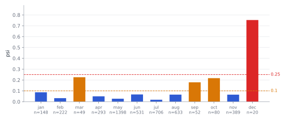
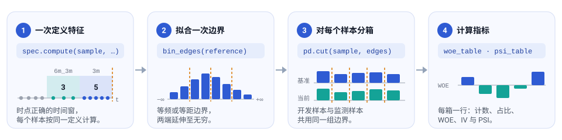

<div align="center">


# kivi

**面向金融风控建模的分箱、WOE、IV 与 PSI**

服务于评分卡开发、变量筛选和模型监控的 pandas 工具包：<br>
拟合一次分箱边界，看清每一箱区分好坏客户的能力，并及时发现客群漂移。

[](https://pypi.org/project/kivi/)
[](https://pypi.org/project/kivi/)
[](https://github.com/gchensy/kivi/actions/workflows/docs.yml)
[](https://www.python.org/)
[](https://pandas.pydata.org/)
[](https://gchensy.github.io/kivi/)
[](https://github.com/gchensy/kivi/blob/master/LICENSE)
[](https://github.com/gchensy/kivi)

[English](https://github.com/gchensy/kivi/blob/master/README.md) · **简体中文**

[使用文档](https://gchensy.github.io/kivi/zh/) ·
[快速上手](https://gchensy.github.io/kivi/zh/getting_started/quickstart.html) ·
[用户指南](https://gchensy.github.io/kivi/zh/user_guide/index.html) ·
[API 参考](https://gchensy.github.io/kivi/zh/api.html) ·
[版本说明](https://gchensy.github.io/kivi/zh/release/index.html)

</div>

---

## ✨ 特性

- 🏦 **为风控团队打造。** 完整覆盖信用评分卡项目：分箱、变量筛选、逻辑回归、分值刻度、模型评估、校准和监控，并提供特殊值、粗分箱和信息泄漏检查的示例。
- 📐 **一次拟合，处处复用。** `bin_edges` 在基准样本上学习等频或等距边界；`chimerge_edges`、`tree_edges` 和 `monotonic_edges` 还会利用目标变量。边界两端延伸至无穷，之后的任何取值都能落入某个箱。
- 🔍 **结果透明。** `woe_table` 和 `psi_table` 返回每箱的原始计数、平滑后的占比和单箱贡献，而不只是一个总数。
- 🧩 **不悄悄丢数据。** 缺失值、`-1` 这类特殊编码、只在一个样本中出现的类别，都会单独成组。
- 🧊 **平滑口径清楚。** 空单元格先按 `smoothing`（默认 0.5）替换再归一化，结果中的计数始终是实际观测数。
- 🐼 **只依赖 pandas 和 NumPy。** 核心不依赖 Spark 和数据库驱动，也不修改全局随机状态。
- 🌏 **中英双语文档，示例全部经过测试。** 两种语言文档中的每个示例都会在 CI 中运行。

## 📊 图表示例

<table>
  <tr>
    <td width="50%" valign="top">
      <a href="https://gchensy.github.io/kivi/zh/user_guide/woe_iv.html#charting-woe"></a>
      <br><b>WOE 图</b>：每箱的客户占比、事件率与 WOE。
    </td>
    <td width="50%" valign="top">
      <a href="https://gchensy.github.io/kivi/zh/user_guide/risk_workflow.html"></a>
      <br><b>变量筛选</b>：按 IV 排序并标出常用的解读区间；<code>duration</code> 存在信息泄漏。
    </td>
  </tr>
  <tr>
    <td colspan="2" valign="top">
      <a href="https://gchensy.github.io/kivi/zh/user_guide/psi.html#monitoring-over-time"></a>
      <br><b>模型监控</b>：各期相对开发样本的 PSI，附 0.1 与 0.25 阈值及样本量。
    </td>
  </tr>
</table>

## 🧭 工作流程

<p align="center">
  
</p>

## 📦 安装

```bash
pip install kivi
```

需要 Python 3.10+、NumPy 1.24+ 和 pandas 2.0+。如需最新开发版，可使用 `pip install "git+https://github.com/gchensy/kivi"`。

> **从 0.2.x 升级？** 0.3 的 API 有较大变化，升级已有代码前请先阅读[迁移指南](https://gchensy.github.io/kivi/zh/release/migration.html)。

## 🚀 快速上手

```python
import pandas as pd
from kivi.binning import bin_edges
from kivi.datasets import Dataset
from kivi.stability import psi_table
from kivi.woe import woe_table

data = Dataset.bank_data()                      # 4,521 位银行营销客户
reference, current = data.iloc[:3000], data.iloc[3000:]

edges = bin_edges(reference["age"], bins=5)     # 1. 只在基准样本上拟合
before = pd.cut(reference["age"], edges)        # 2. 每个样本复用同一组边界
after = pd.cut(current["age"], edges)

evidence = woe_table(before, reference["target"])  # 3. 计算指标
stability = psi_table(before, after)

print(evidence[["event", "non_event", "woe", "iv"]].round(3))
print(f"IV = {evidence['iv'].sum():.3f}, PSI = {stability['psi'].sum():.4f}")
```

```text
              event  non_event    woe     iv
bin
(-inf, 32.0]     90        612  0.114  0.003
(32.0, 36.0]     55        475 -0.125  0.003
(36.0, 42.0]     58        529 -0.180  0.006
(42.0, 51.0]     71        569 -0.050  0.001
(51.0, inf]      74        467  0.189  0.007
IV = 0.019, PSI = 0.0024
```

类别变量无需边界，直接传入：

```python
jobs = woe_table(reference["job"], reference["target"])
print(f"IV(job) = {jobs['iv'].sum():.3f}")      # IV(job) = 0.137
```

## 🧰 API 一览

| 函数 | 用途 |
| --- | --- |
| [`kivi.binning.bin_edges`](https://gchensy.github.io/kivi/zh/api/binning.html#kivi.binning.bin_edges) | 在基准样本上拟合等频或等距边界，两端为无穷 |
| [`kivi.binning.cut`](https://gchensy.github.io/kivi/zh/api/binning.html#kivi.binning.cut) | 将取值分配到各箱，每个特殊值（如 `-1`）单独成组 |
| [`kivi.binning.chimerge_edges`](https://gchensy.github.io/kivi/zh/api/binning.html#kivi.binning.chimerge_edges) | 用 ChiMerge 合并等频细分箱，直到相邻箱差异显著 |
| [`kivi.binning.tree_edges`](https://gchensy.github.io/kivi/zh/api/binning.html#kivi.binning.tree_edges) | 按熵或基尼指数做决策树切分，并限制每箱最小占比 |
| [`kivi.binning.monotonic_edges`](https://gchensy.github.io/kivi/zh/api/binning.html#kivi.binning.monotonic_edges) | 合并等频细分箱，直到 WOE 单调 |
| [`kivi.woe.woe_table`](https://gchensy.github.io/kivi/zh/api/woe.html#kivi.woe.woe_table) | 每组的计数、占比、WOE 与 IV |
| [`kivi.woe.woe_transform`](https://gchensy.github.io/kivi/zh/api/woe.html#kivi.woe.woe_transform) | 用开发样本的 WOE 替换每个分组，未见过的分组需明确处理方式 |
| [`kivi.woe.woe`](https://gchensy.github.io/kivi/zh/api/woe.html#kivi.woe.woe), [`kivi.woe.iv`](https://gchensy.github.io/kivi/zh/api/woe.html#kivi.woe.iv), [`kivi.stability.psi`](https://gchensy.github.io/kivi/zh/api/stability.html#kivi.stability.psi) | 直接从已汇总的计数计算 WOE、IV 和 PSI |
| [`kivi.stability.psi_table`](https://gchensy.github.io/kivi/zh/api/stability.html#kivi.stability.psi_table) | 两个样本逐组的 PSI 贡献 |
| [`kivi.metrics.roc_auc`](https://gchensy.github.io/kivi/zh/api/metrics.html#kivi.metrics.roc_auc), [`kivi.metrics.gini`](https://gchensy.github.io/kivi/zh/api/metrics.html#kivi.metrics.gini), [`kivi.metrics.ks`](https://gchensy.github.io/kivi/zh/api/metrics.html#kivi.metrics.ks), [`kivi.metrics.brier_score`](https://gchensy.github.io/kivi/zh/api/metrics.html#kivi.metrics.brier_score) | 分数或 PD 相对二分类目标的 AUC、Gini、KS 和 Brier 分数 |
| [`kivi.metrics.gains_table`](https://gchensy.github.io/kivi/zh/api/metrics.html#kivi.metrics.gains_table) | 按分数段统计的增益与提升，含累计捕获率和 KS |
| [`kivi.selection.correlation_filter`](https://gchensy.github.io/kivi/zh/api/selection.html#kivi.selection.correlation_filter), [`kivi.selection.vif`](https://gchensy.github.io/kivi/zh/api/selection.html#kivi.selection.vif) | 按 IV 剔除高度相关的变量，并计算方差膨胀因子 |
| [`kivi.selection.logistic_regression`](https://gchensy.github.io/kivi/zh/api/selection.html#kivi.selection.logistic_regression), [`kivi.selection.stepwise`](https://gchensy.github.io/kivi/zh/api/selection.html#kivi.selection.stepwise) | 基于 NumPy 的逻辑回归，以及保证系数全为正的逐步回归 |
| [`kivi.scorecard.points_table`](https://gchensy.github.io/kivi/zh/api/scorecard.html#kivi.scorecard.points_table), [`kivi.scorecard.woe_to_points`](https://gchensy.github.io/kivi/zh/api/scorecard.html#kivi.scorecard.woe_to_points), [`kivi.scorecard.reason_codes`](https://gchensy.github.io/kivi/zh/api/scorecard.html#kivi.scorecard.reason_codes) | 按 PDO 刻度计算每组分值、为新数据打分并给出原因码 |
| [`kivi.scorecard.pd_to_score`](https://gchensy.github.io/kivi/zh/api/scorecard.html#kivi.scorecard.pd_to_score), [`kivi.scorecard.score_to_pd`](https://gchensy.github.io/kivi/zh/api/scorecard.html#kivi.scorecard.score_to_pd) | PD 与分数互相换算 |
| [`kivi.calibration.calibration_table`](https://gchensy.github.io/kivi/zh/api/calibration.html#kivi.calibration.calibration_table), [`kivi.calibration.binomial_test`](https://gchensy.github.io/kivi/zh/api/calibration.html#kivi.calibration.binomial_test), [`kivi.calibration.jeffreys_test`](https://gchensy.github.io/kivi/zh/api/calibration.html#kivi.calibration.jeffreys_test), [`kivi.calibration.hosmer_lemeshow`](https://gchensy.github.io/kivi/zh/api/calibration.html#kivi.calibration.hosmer_lemeshow) | 按评级比较事件率与预测 PD，并做二项、Jeffreys 和 Hosmer-Lemeshow 检验 |
| [`kivi.calibration.prior_correction`](https://gchensy.github.io/kivi/zh/api/calibration.html#kivi.calibration.prior_correction), [`kivi.calibration.corrected_intercept`](https://gchensy.github.io/kivi/zh/api/calibration.html#kivi.calibration.corrected_intercept), [`kivi.calibration.herfindahl_index`](https://gchensy.github.io/kivi/zh/api/calibration.html#kivi.calibration.herfindahl_index) | 对过采样样本校正 PD，并度量评级集中度 |
| [`kivi.datasets.Dataset.bank_data`](https://gchensy.github.io/kivi/zh/api/datasets.html#kivi.datasets.Dataset.bank_data) | 随包的银行营销示例数据 |

## 📚 文档

| | 中文 | English |
| --- | --- | --- |
| 快速上手 | [阅读](https://gchensy.github.io/kivi/zh/getting_started/quickstart.html) | [Read](https://gchensy.github.io/kivi/en/getting_started/quickstart.html) |
| 分箱 | [阅读](https://gchensy.github.io/kivi/zh/user_guide/binning.html) | [Read](https://gchensy.github.io/kivi/en/user_guide/binning.html) |
| WOE 与 IV | [阅读](https://gchensy.github.io/kivi/zh/user_guide/woe_iv.html) | [Read](https://gchensy.github.io/kivi/en/user_guide/woe_iv.html) |
| PSI | [阅读](https://gchensy.github.io/kivi/zh/user_guide/psi.html) | [Read](https://gchensy.github.io/kivi/en/user_guide/psi.html) |
| 风控建模流程 | [阅读](https://gchensy.github.io/kivi/zh/user_guide/risk_workflow.html) | [Read](https://gchensy.github.io/kivi/en/user_guide/risk_workflow.html) |
| 变量筛选 | [阅读](https://gchensy.github.io/kivi/zh/user_guide/selection.html) | [Read](https://gchensy.github.io/kivi/en/user_guide/selection.html) |
| 评分卡 | [阅读](https://gchensy.github.io/kivi/zh/user_guide/scorecard.html) | [Read](https://gchensy.github.io/kivi/en/user_guide/scorecard.html) |
| 模型表现 | [阅读](https://gchensy.github.io/kivi/zh/user_guide/metrics.html) | [Read](https://gchensy.github.io/kivi/en/user_guide/metrics.html) |
| 校准 | [阅读](https://gchensy.github.io/kivi/zh/user_guide/calibration.html) | [Read](https://gchensy.github.io/kivi/en/user_guide/calibration.html) |
| 从 0.2.x 迁移 | [阅读](https://gchensy.github.io/kivi/zh/release/migration.html) | [Read](https://gchensy.github.io/kivi/en/release/migration.html) |

## 🗺️ 路线图

- ✅ 基于 pandas 核心的等频与等距分箱、WOE、IV 和 PSI
- ✅ 中英文文档，示例经过测试
- ✅ `-1`、`-999` 等特殊值单独分箱
- ✅ 带图表的风控示例：特殊值、粗分箱、IV 筛选、PSI 监控
- ✅ 有监督分箱：ChiMerge、决策树与单调 WOE
- ✅ 新数据的 WOE 编码，未见过的分组需明确处理方式
- ✅ 分箱、WOE 和 PSI 支持样本权重
- ✅ 评分卡流程：变量筛选、逻辑回归、PDO 刻度、原因码、模型评估与校准
- 🔜 CSI、账龄（vintage）与滚动率分析，批量分箱并保存分箱规格
- 🔜 策略分析：cut-off、换入换出、拒绝推断与预期损失

## 🤝 参与贡献

```bash
git clone https://github.com/gchensy/kivi.git
cd kivi
python -m pip install -e '.[test,docs,lint]'
pre-commit install                                        # 每次提交前运行 ruff
python -m pytest                                          # 单元测试
python -m sphinx -W -b doctest docs docs/_build/doctest   # 文档示例
python docs/build.py                                      # 中英文 HTML 文档
```

修改英文文档或 docstring 后，运行 `python docs/build.py --update-po`，并补全 `docs/locale/zh_CN/LC_MESSAGES/kivi.po` 中的新条目。详见[开发指南](https://gchensy.github.io/kivi/zh/development/index.html)。

## 📄 许可

源代码采用 [MIT 许可证](https://github.com/gchensy/kivi/blob/master/LICENSE)。内置的 Bank Marketing 数据由 S. Moro、P. Rita 和 P. Cortez（2014）发布，按 CC BY 4.0 授权，详见 [DATA-LICENSE.txt](https://github.com/gchensy/kivi/blob/master/DATA-LICENSE.txt)。

<div align="center">

<sub>如果 kivi 对你的模型有帮助，欢迎点一个 ⭐，让更多人看到它。</sub>

</div>
